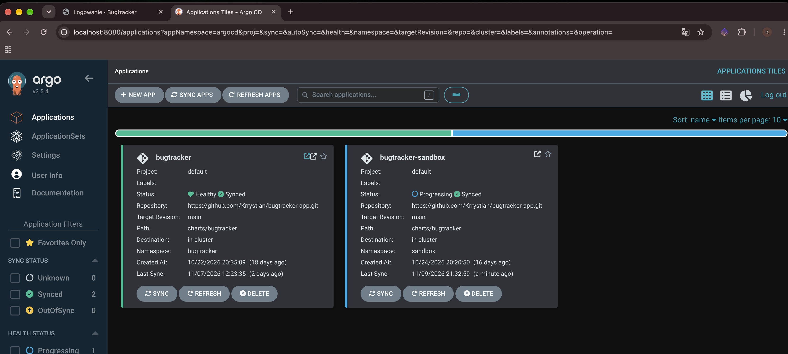
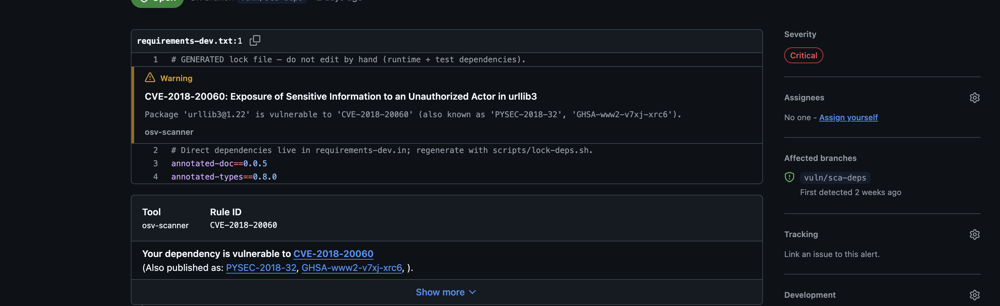
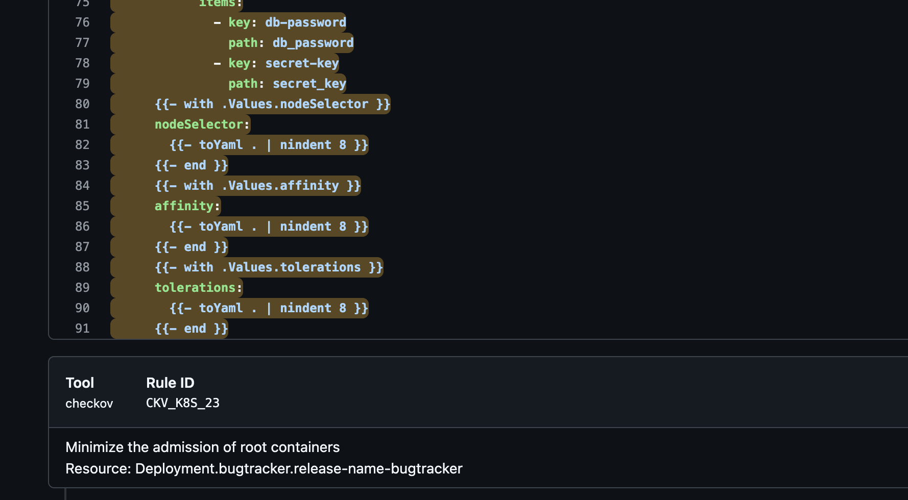

# Raport wdrożenia: Bugtracker w klastrze Kubernetes

Projekt „Bezpieczny potok GitOps (DevSecOps)”. Raport potwierdza wdrożenie systemu w klastrze Kubernetes (k3d) i przedstawia wyniki testów zaplanowanych w zadaniu cząstkowym nr 2 (testy akceptacyjne T1–T5) oraz testów obiektów Kubernetes.

- Repozytorium aplikacji (kod, Dockerfile, wykres Helm `charts/bugtracker`, manifesty, CI): https://github.com/Krrystian/bugtracker-app
- Repozytorium GitOps (wartości środowiska, `Application` Argo CD, `SealedSecret`): https://github.com/Krrystian/bugtracker-gitops

Wyniki poleceń w tym raporcie to prawdziwe wyniki z klastra `k3d-bugtracker`, zebrane 2026-11-07 po wdrożeniu wykresu w wersji 0.2.0 (commit `cdd8935` w `main`).

## Spis treści

1. [System i architektura](#1-system-i-architektura)
2. [Wymagane obiekty Kubernetes: gdzie są w repozytorium](#2-wymagane-obiekty-kubernetes-gdzie-są-w-repozytorium)
3. [Potwierdzenie wdrożenia](#3-potwierdzenie-wdrożenia)
4. [Testy obiektów Kubernetes](#4-testy-obiektów-kubernetes)
5. [Testy akceptacyjne T1–T5](#5-testy-akceptacyjne-t1t5)
6. [Gałęzie z podatnościami `vuln/*`](#6-gałęzie-z-podatnościami-vuln)
7. [Podsumowanie](#7-podsumowanie)

## 1. System i architektura

**Aplikacja:** bugtracker w Pythonie (FastAPI) z bazą PostgreSQL 16. Udostępnia interfejs webowy, API CRUD zgłoszeń, logowanie (hasła Argon2id) i endpoint `/health`, który sprawdza także połączenie z bazą.

**Klaster:** k3d (k3s v1.36.4) na Docker Desktop, jeden węzeł. W klastrze działają:

| Komponent | Rola |
|---|---|
| Traefik (wbudowany w k3s) | kontroler Ingress, `http://localhost` |
| Argo CD v3.5.4 | GitOps: wdraża aplikację z repozytoriów Git (Multiple Sources) |
| Sealed Secrets v0.40.0 | odszyfrowuje zaszyfrowane `SealedSecret` z repo GitOps do zwykłych `Secret` |
| Kyverno v1.19.1 | admission control: wpuszcza tylko obrazy podpisane kluczem Cosign projektu |
| cloudflared (Quick Tunnel) | tunel **wyłącznie** dla webhooka GitHub → Argo CD (`/api/webhook`) |

**Przepływ wdrożenia:**

```
push/PR ─► GitHub Actions (repo aplikacji)
           Semgrep, OSV-Scanner, Checkov, Gitleaks, Hadolint ─► build ─► Trivy, SBOM ─► DAST (ZAP w tymczasowym k3d)
           └─ tylko main, wszystkie bramki zielone: push do Docker Hub (tag = SHA commitu), podpis Cosign,
              repository_dispatch ─► repo GitOps: commit z nowym tagiem na gałęzi development
                                     └─ ręczny PR development ─► main (brama decyzyjna)
                                        └─ webhook ─► Cloudflare Tunnel ─► Argo CD ─► klaster k3d
                                           (wykres Helm z repo aplikacji + values i SealedSecret z repo GitOps)
                                           └─ Kyverno weryfikuje podpis obrazu przy tworzeniu poda
```

Aplikacja jest wdrażana jako wykres Helm `charts/bugtracker`. Argo CD `Application` `bugtracker` łączy trzy źródła: wykres z `bugtracker-app@main`, plik `environments/development/values.yaml` z `bugtracker-gitops@main` (referencja `$values`) i katalog `environments/development/secrets/` z zaszyfrowanymi sekretami.

## 2. Wymagane obiekty Kubernetes: gdzie są w repozytorium

Ścieżki względem repozytorium `bugtracker-app`, chyba że zaznaczono inaczej. Wszystkie obiekty działają w namespace `bugtracker`.

| Obiekt | Nazwa w klastrze | Plik |
|---|---|---|
| Deployment | `bugtracker` (aplikacja, 2 repliki) | `templates/deployment.yaml` |
| StatefulSet | `bugtracker-postgres` (baza) | `templates/postgres-statefulset.yaml` |
| Service | `bugtracker`, `bugtracker-postgres`, `bugtracker-postgres-headless` | `templates/service.yaml`, `templates/postgres-service.yaml` |
| NetworkPolicy | `bugtracker-default-deny`, `bugtracker-app`, `bugtracker-postgres` | `templates/networkpolicy.yaml` |
| Ingress | `bugtracker` (host `localhost`) | `templates/ingress.yaml` |
| PVC | `data-bugtracker-postgres-0` | `templates/postgres-statefulset.yaml` |
| ConfigMap | `bugtracker-config` | `templates/configmap.yaml` |
| Secret | `bugtracker-secrets` (tworzony z `SealedSecret`) | repo GitOps: `environments/development/secrets/` |
| Requests i Limits | każdy kontener | `values.yaml` |
| ResourceQuota | `bugtracker-quota` | `templates/resourcequota.yaml` |
| LimitRange | `bugtracker-limits` | `templates/limitrange.yaml` |

Pliki `templates/` i `values.yaml` są w katalogu wykresu `charts/bugtracker/`. Statyczne manifesty (Docker Desktop, bez Helma) leżą w katalogu `k8s/`: `namespace.yaml`, `deployment.yaml`, `service.yaml`, `ingress.yaml`, `pvc.yaml`, `networkpolicy.yaml`.

### Obiekty i mechanizmy dodatkowe

- **ServiceAccount bez tokenu:** pody nie dostają tokenu do API Kubernetes, więc przejęta aplikacja nie może sterować klastrem.
- **Pod Security `restricted` na namespace:** klaster odrzuca pody działające jako root, `privileged` albo z podnoszeniem uprawnień.
- **SealedSecret:** hasła są w repo zaszyfrowane i odszyfrować je może tylko klaster.
- **Argo CD `Application`:** stan klastra wynika z Gita, a ręczne zmiany są cofane. Osobna aplikacja `sandbox` służy do testowania podatnych wersji.
- **Polityka Kyverno** (`infra/kyverno/verify-images.yaml`): pod uruchomi tylko obraz podpisany naszym kluczem Cosign.
- **securityContext:** kontenery działają bez roota, z systemem plików tylko do odczytu i bez dodatkowych uprawnień.
- **Sondy (startup, readiness, liveness):** ruch trafia tylko do gotowych podów, a zawieszone kontenery są restartowane.
- **Sekrety jako pliki** (`/run/secrets/bugtracker`), a nie zmienne środowiskowe, które łatwiej wyciekają.
- **`Retain` dla wolumenu bazy:** usunięcie StatefulSet nie kasuje danych.
- **Headless Service:** daje podowi bazy stałą nazwę DNS.
- **`checksum/config`:** zmiana ConfigMap automatycznie restartuje pody.

## 3. Potwierdzenie wdrożenia

### 3.1. Klaster i namespace

```console
$ kubectl config current-context; k3d cluster list; kubectl get nodes -o wide
k3d-bugtracker
NAME         SERVERS   AGENTS   LOADBALANCER
bugtracker   1/1       0/0      true
NAME                      STATUS   ROLES           AGE   VERSION        INTERNAL-IP   EXTERNAL-IP   OS-IMAGE           KERNEL-VERSION            CONTAINER-RUNTIME
k3d-bugtracker-server-0   Ready    control-plane   16d   v1.36.4+k3s1   172.18.0.2    <none>        K3s v1.36.4+k3s1   7.0.14-linuxkit (arm64)   containerd://2.3.4-k3s1.36
```

```console
$ kubectl get ns bugtracker --show-labels
NAME         STATUS   AGE   LABELS
bugtracker   Active   16d   kubernetes.io/metadata.name=bugtracker,pod-security.kubernetes.io/enforce=restricted
```

### 3.2. Wszystkie obiekty w namespace `bugtracker`

```console
$ kubectl -n bugtracker get all,pvc,cm,secret,quota,limitrange,networkpolicy,ingress
NAME                             READY   STATUS    RESTARTS   AGE
pod/bugtracker-87c664bdb-dz4x6   1/1     Running   0          28m
pod/bugtracker-87c664bdb-r49sd   1/1     Running   0          28m
pod/bugtracker-postgres-0        1/1     Running   0          28m

NAME                                   TYPE        CLUSTER-IP      EXTERNAL-IP   PORT(S)    AGE
service/bugtracker                     ClusterIP   10.43.195.4     <none>        80/TCP     16d
service/bugtracker-postgres            ClusterIP   10.43.103.141   <none>        5432/TCP   16d
service/bugtracker-postgres-headless   ClusterIP   None            <none>        5432/TCP   28m

NAME                         READY   UP-TO-DATE   AVAILABLE   AGE
deployment.apps/bugtracker   2/2     2            2           16d

NAME                                    DESIRED   CURRENT   READY   AGE
replicaset.apps/bugtracker-6746bf47bf   0         0         0       14d
replicaset.apps/bugtracker-689d4788     0         0         0       15d
replicaset.apps/bugtracker-69f99989ff   0         0         0       13d
replicaset.apps/bugtracker-6bdfb689d9   0         0         0       13d
replicaset.apps/bugtracker-7748c65c89   0         0         0       13d
replicaset.apps/bugtracker-77b46f86bb   0         0         0       16d
replicaset.apps/bugtracker-77f554f595   0         0         0       14d
replicaset.apps/bugtracker-78c8c6b6fb   0         0         0       15d
replicaset.apps/bugtracker-87c664bdb    2         2         2       28m
replicaset.apps/bugtracker-b64b7d6b9    0         0         0       13d
replicaset.apps/bugtracker-f8c74bc66    0         0         0       14d

NAME                                   READY   AGE
statefulset.apps/bugtracker-postgres   1/1     28m

NAME                                               STATUS   VOLUME                                     CAPACITY   ACCESS MODES   STORAGECLASS   VOLUMEATTRIBUTESCLASS   AGE
persistentvolumeclaim/data-bugtracker-postgres-0   Bound    pvc-a9664699-f49c-49bf-af6d-374023f214d6   1Gi        RWO            local-path     <unset>                 28m

NAME                          DATA   AGE
configmap/bugtracker-config   7      28m
configmap/kube-root-ca.crt    1      16d

NAME                                      TYPE                 DATA   AGE
secret/bugtracker-secrets                 Opaque               2      16d
secret/bugtracker-t5-demo                 Opaque               1      13d
secret/sh.helm.release.v1.bugtracker.v1   helm.sh/release.v1   1      16d

NAME                             REQUEST                                                                                                                                                                                     LIMIT                                         AGE
resourcequota/bugtracker-quota   persistentvolumeclaims: 1/3, pods: 3/10, requests.cpu: 200m/1, requests.memory: 320Mi/1Gi, requests.storage: 1Gi/5Gi, services: 3/5, services.loadbalancers: 0/0, services.nodeports: 0/0   limits.cpu: 1500m/3, limits.memory: 1Gi/2Gi   28m

NAME                           CREATED AT
limitrange/bugtracker-limits   2026-11-07T10:58:48Z

NAME                                                      POD-SELECTOR                                                                                                   AGE
networkpolicy.networking.k8s.io/bugtracker-app            app.kubernetes.io/component=app,app.kubernetes.io/instance=bugtracker,app.kubernetes.io/name=bugtracker        16d
networkpolicy.networking.k8s.io/bugtracker-default-deny   app.kubernetes.io/instance=bugtracker                                                                          16d
networkpolicy.networking.k8s.io/bugtracker-postgres       app.kubernetes.io/component=database,app.kubernetes.io/instance=bugtracker,app.kubernetes.io/name=bugtracker   16d

NAME                                   CLASS     HOSTS       ADDRESS      PORTS   AGE
ingress.networking.k8s.io/bugtracker   traefik   localhost   172.18.0.2   80      16d
```

Uwagi do wyniku:
- ReplicaSety z `DESIRED 0` to historia Deploymentu (rollback). Kubernetes przechowuje je domyślnie (`revisionHistoryLimit: 10`).
- `secret/sh.helm.release.v1.bugtracker.v1` został po próbnej instalacji `helm install`. Argo CD nie używa Helma do instalacji (renderuje szablony), więc ten obiekt nie jest już używany.

### 3.3. Deployment (aplikacja) i StatefulSet (baza)

```console
$ kubectl -n bugtracker get deploy bugtracker -o wide
NAME         READY   UP-TO-DATE   AVAILABLE   AGE   CONTAINERS   IMAGES                                                         SELECTOR
bugtracker   2/2     2            2           16d   bugtracker   krys3x15/bugtracker:1d205e66f614322088c4159838b83ee136f5177d   app.kubernetes.io/component=app,app.kubernetes.io/instance=bugtracker,app.kubernetes.io/name=bugtracker
```

```console
$ kubectl -n bugtracker get sts bugtracker-postgres -o wide
NAME                  READY   AGE   CONTAINERS   IMAGES
bugtracker-postgres   1/1     28m   postgres     postgres:16.15-alpine@sha256:721873c34ceb9f8d8fc265984940dc982404c105f19ad51be9fdc5970a6080ea
```

```console
$ kubectl -n bugtracker get sts bugtracker-postgres -o jsonpath='serviceName={.spec.serviceName} retention={.spec.persistentVolumeClaimRetentionPolicy}{"\n"}'; kubectl -n bugtracker get pod bugtracker-postgres-0 -o jsonpath='{.spec.volumes[?(@.name=="data")].persistentVolumeClaim.claimName}{"\n"}'
serviceName=bugtracker-postgres-headless retention={"whenDeleted":"Retain","whenScaled":"Retain"}
data-bugtracker-postgres-0
```

Obraz aplikacji ma tag równy pełnemu SHA commitu, nie `latest`. Kyverno przy tworzeniu poda dopisał zweryfikowany digest:

```console
$ kubectl get imagevalidatingpolicy 2>/dev/null || kubectl get clusterpolicy; kubectl -n bugtracker get sa; kubectl -n bugtracker get pod -l app.kubernetes.io/component=app -o jsonpath='{.items[0].spec.containers[0].image}{"\n"}'
NAME                       AGE   READY
verify-bugtracker-images   13d   true
NAME         AGE
bugtracker   16d
default      16d
docker.io/krys3x15/bugtracker:1d205e66f614322088c4159838b83ee136f5177d@sha256:fb2464faac3be55123ba200bda75013038f915ef15564ee9d2dabb9905cf3fa3
```

### 3.4. Service i Ingress

```console
$ kubectl -n bugtracker get svc -o wide
NAME                           TYPE        CLUSTER-IP      EXTERNAL-IP   PORT(S)    AGE   SELECTOR
bugtracker                     ClusterIP   10.43.195.4     <none>        80/TCP     16d   app.kubernetes.io/component=app,app.kubernetes.io/instance=bugtracker,app.kubernetes.io/name=bugtracker
bugtracker-postgres            ClusterIP   10.43.103.141   <none>        5432/TCP   16d   app.kubernetes.io/component=database,app.kubernetes.io/instance=bugtracker,app.kubernetes.io/name=bugtracker
bugtracker-postgres-headless   ClusterIP   None            <none>        5432/TCP   28m   app.kubernetes.io/component=database,app.kubernetes.io/instance=bugtracker,app.kubernetes.io/name=bugtracker
```

```console
$ kubectl -n bugtracker get ingress -o wide; curl -s -i http://localhost/health | head -12
NAME         CLASS     HOSTS       ADDRESS      PORTS   AGE
bugtracker   traefik   localhost   172.18.0.2   80      16d
HTTP/1.1 200 OK
Cache-Control: no-store
Content-Length: 31
Content-Security-Policy: default-src 'none'; style-src 'self'; form-action 'self'; frame-ancestors 'none'; base-uri 'none'
Content-Type: application/json
Date: Sat, 07 Nov 2026 11:27:27 GMT
Referrer-Policy: no-referrer
Server: uvicorn
X-Content-Type-Options: nosniff
X-Frame-Options: DENY

{"status":"ok","database":"ok"}
```


### 3.5. PVC i trwałość danych

```console
$ kubectl -n bugtracker get pvc -o wide; kubectl get pv
NAME                         STATUS   VOLUME                                     CAPACITY   ACCESS MODES   STORAGECLASS   VOLUMEATTRIBUTESCLASS   AGE   VOLUMEMODE
data-bugtracker-postgres-0   Bound    pvc-a9664699-f49c-49bf-af6d-374023f214d6   1Gi        RWO            local-path     <unset>                 28m   Filesystem
NAME                                       CAPACITY   ACCESS MODES   RECLAIM POLICY   STATUS   CLAIM                                   STORAGECLASS   VOLUMEATTRIBUTESCLASS   REASON   AGE
pvc-a9664699-f49c-49bf-af6d-374023f214d6   1Gi        RWO            Delete           Bound    bugtracker/data-bugtracker-postgres-0   local-path     <unset>                          28m
```

Przejście bazy z Deploymentu na StatefulSet (2026-11-07) zrobiłem tak:
1. kopia bazy (`pg_dump -Fc`, poza repozytorium),
2. adnotacja `argocd.argoproj.io/sync-options=Prune=false` na starym PVC, żeby Argo CD go nie usunął,
3. scalenie zmiany wykresu, po którym Argo CD utworzył StatefulSet z nowym PVC `data-bugtracker-postgres-0`,
4. odtworzenie danych (`pg_restore`): 2 zgłoszenia i 3 użytkowników, zgodnie z kopią,
5. po weryfikacji usunięcie starego PVC `bugtracker-postgres-data`; Argo CD wrócił do stanu `Synced`.

Dane w nowej bazie:

```console
$ kubectl -n bugtracker exec bugtracker-postgres-0 -- psql -U bugtracker -d bugtracker -Atc 'select count(*) from bugs'; kubectl -n bugtracker exec deploy/bugtracker -- sh -c 'env | grep -E "^(DB_|SECRETS_DIR|ENABLE_DOCS|COOKIE_SECURE)" | sort; ls -l /run/secrets/bugtracker/'
2
COOKIE_SECURE=false
DB_HOST=bugtracker-postgres
DB_NAME=bugtracker
DB_PORT=5432
DB_USER=bugtracker
ENABLE_DOCS=false
SECRETS_DIR=/run/secrets/bugtracker
total 0
lrwxrwxrwx 1 root app 18 Nov  7 10:59 db_password -> ..data/db_password
lrwxrwxrwx 1 root app 17 Nov  7 10:59 secret_key -> ..data/secret_key
```

Ostatnie polecenie pokazuje też, że aplikacja dostała konfigurację z ConfigMap jako zmienne środowiskowe, a sekrety jako pliki w `/run/secrets/bugtracker`.

### 3.6. ConfigMap

```console
$ kubectl -n bugtracker describe configmap bugtracker-config
Name:         bugtracker-config
Namespace:    bugtracker
Labels:       app.kubernetes.io/instance=bugtracker
              app.kubernetes.io/managed-by=Helm
              app.kubernetes.io/name=bugtracker
              helm.sh/chart=bugtracker-0.2.0
Annotations:  argocd.argoproj.io/tracking-id: bugtracker:/ConfigMap:bugtracker/bugtracker-config

Data
====
COOKIE_SECURE:
----
false

DB_HOST:
----
bugtracker-postgres

DB_NAME:
----
bugtracker

DB_PORT:
----
5432

DB_USER:
----
bugtracker

ENABLE_DOCS:
----
false

SECRETS_DIR:
----
/run/secrets/bugtracker


BinaryData
====

Events:  <none>
```

### 3.7. Secret (z SealedSecret)

Wartości sekretów nie są wypisywane. `describe` pokazuje tylko nazwy kluczy i rozmiary.

```console
$ kubectl -n bugtracker get sealedsecret; kubectl -n bugtracker describe secret bugtracker-secrets
NAME                 AGE
bugtracker-secrets   13d
bugtracker-t5-demo   13d
Name:         bugtracker-secrets
Namespace:    bugtracker
Labels:       <none>
Annotations:  <none>

Type:  Opaque

Data
====
db-password:  32 bytes
secret-key:   64 bytes
```

### 3.8. NetworkPolicy

```console
$ kubectl -n bugtracker get networkpolicy; kubectl -n bugtracker describe networkpolicy bugtracker-postgres
NAME                      POD-SELECTOR                                                                                                   AGE
bugtracker-app            app.kubernetes.io/component=app,app.kubernetes.io/instance=bugtracker,app.kubernetes.io/name=bugtracker        16d
bugtracker-default-deny   app.kubernetes.io/instance=bugtracker                                                                          16d
bugtracker-postgres       app.kubernetes.io/component=database,app.kubernetes.io/instance=bugtracker,app.kubernetes.io/name=bugtracker   16d
Name:         bugtracker-postgres
Namespace:    bugtracker
Created on:   2026-10-22 09:35:28 +0200 CEST
Labels:       app.kubernetes.io/instance=bugtracker
              app.kubernetes.io/managed-by=Helm
              app.kubernetes.io/name=bugtracker
              helm.sh/chart=bugtracker-0.2.0
Annotations:  argocd.argoproj.io/tracking-id: bugtracker:networking.k8s.io/NetworkPolicy:bugtracker/bugtracker-postgres
              meta.helm.sh/release-name: bugtracker
              meta.helm.sh/release-namespace: bugtracker
Spec:
  PodSelector:     app.kubernetes.io/component=database,app.kubernetes.io/instance=bugtracker,app.kubernetes.io/name=bugtracker
  Allowing ingress traffic:
    To Port: 5432/TCP
    From:
      PodSelector: app.kubernetes.io/component=app,app.kubernetes.io/instance=bugtracker,app.kubernetes.io/name=bugtracker
  Allowing egress traffic:
    <none> (Selected pods are isolated for egress connectivity)
  Policy Types: Ingress, Egress
```

### 3.9. Requests i Limits, ResourceQuota, LimitRange

```console
$ kubectl -n bugtracker get pods -o custom-columns='POD:.metadata.name,CPU_REQ:.spec.containers[*].resources.requests.cpu,MEM_REQ:.spec.containers[*].resources.requests.memory,CPU_LIM:.spec.containers[*].resources.limits.cpu,MEM_LIM:.spec.containers[*].resources.limits.memory'
POD                          CPU_REQ   MEM_REQ   CPU_LIM   MEM_LIM
bugtracker-87c664bdb-dz4x6   50m       96Mi      500m      256Mi
bugtracker-87c664bdb-r49sd   50m       96Mi      500m      256Mi
bugtracker-postgres-0        100m      128Mi     500m      512Mi
```

```console
$ kubectl -n bugtracker describe resourcequota bugtracker-quota
Name:                   bugtracker-quota
Namespace:              bugtracker
Resource                Used   Hard
--------                ----   ----
limits.cpu              1500m  3
limits.memory           1Gi    2Gi
persistentvolumeclaims  1      3
pods                    3      10
requests.cpu            200m   1
requests.memory         320Mi  1Gi
requests.storage        1Gi    5Gi
services                3      5
services.loadbalancers  0      0
services.nodeports      0      0
```

```console
$ kubectl -n bugtracker describe limitrange bugtracker-limits
Name:                  bugtracker-limits
Namespace:             bugtracker
Type                   Resource  Min    Max  Default Request  Default Limit  Max Limit/Request Ratio
----                   --------  ---    ---  ---------------  -------------  -----------------------
Container              cpu       10m    1    50m              250m           -
Container              memory    32Mi   1Gi  64Mi             256Mi          -
PersistentVolumeClaim  storage   100Mi  2Gi  -                -              -
```

ResourceQuota jest dobrana do 2 podów aplikacji, 1 dodatkowego poda podczas rolling update i bazy, z zapasem. Zabrania usług `LoadBalancer` i `NodePort`, więc aplikacji nie da się wystawić z pominięciem Ingress.

### 3.10. Argo CD i Kyverno

```console
$ kubectl -n argocd get applications; kubectl -n argocd get application bugtracker -o jsonpath='{range .status.resources[?(@.status!="Synced")]}{.kind}/{.name}: {.status}{"\n"}{end}'
NAME                 SYNC STATUS   HEALTH STATUS
bugtracker           Synced        Healthy
bugtracker-sandbox   OutOfSync     Degraded
```




Aplikacja `bugtracker` jest `Synced` i `Healthy`: stan klastra zgadza się z repozytoriami. Aplikacja `bugtracker-sandbox` (piaskownica, ręczna synchronizacja) jest `Degraded` celowo: Kyverno nie wpuszcza tam niepodpisanego obrazu (test T3).

## 4. Testy obiektów Kubernetes

Testy wykonano na działającym klastrze. Polecenia z `--dry-run=server` przechodzą przez pełną walidację i admission serwera API (LimitRange, ResourceQuota, Pod Security), ale niczego nie tworzą.

### 4.1. LimitRange: kontener chce więcej niż maksimum

Cel: kontener z limitem 2 CPU (maksimum LimitRange to 1 CPU) ma zostać odrzucony.

```console
$ kubectl -n bugtracker run test-limitrange --image=postgres:16.15-alpine@sha256:721873c34ceb9f8d8fc265984940dc982404c105f19ad51be9fdc5970a6080ea --restart=Never --dry-run=server --overrides="$(cat o1.json)"
Error from server (Forbidden): pods "test-limitrange" is forbidden: maximum cpu usage per Container is 1, but limit is 2
```

**Wynik:** odrzucony przez LimitRange.

### 4.2. LimitRange: wartości domyślne

Cel: kontener **bez** `resources` dostaje domyślne requests/limits z LimitRange.

```console
$ kubectl -n bugtracker run test-defaults --image=postgres:16.15-alpine@sha256:721873c34ceb9f8d8fc265984940dc982404c105f19ad51be9fdc5970a6080ea --restart=Never --dry-run=server --overrides="$(cat o3.json)" -o jsonpath='{.spec.containers[0].resources}{"\n"}'
{"limits":{"cpu":"250m","memory":"256Mi"},"requests":{"cpu":"50m","memory":"64Mi"}}
```

**Wynik:** serwer dopisał `requests 50m/64Mi` i `limits 250m/256Mi`.

### 4.3. ResourceQuota: przekroczenie limitu namespace'u

Cel: pod z `requests.cpu: 900m` (pojedynczo w granicach LimitRange) przekroczyłby łączny limit `requests.cpu: 1` namespace'u (200m jest już zajęte).

```console
$ kubectl -n bugtracker run test-quota --image=postgres:16.15-alpine@sha256:721873c34ceb9f8d8fc265984940dc982404c105f19ad51be9fdc5970a6080ea --restart=Never --dry-run=server --overrides="$(cat o2.json)"
Error from server (Forbidden): pods "test-quota" is forbidden: exceeded quota: bugtracker-quota, requested: requests.cpu=900m, used: requests.cpu=200m, limited: requests.cpu=1
```

**Wynik:** odrzucony przez ResourceQuota.

```console
$ kubectl -n bugtracker create service loadbalancer test-lb --tcp=80:8000 --dry-run=server
error: failed to create LoadBalancer service: services "test-lb" is forbidden: exceeded quota: bugtracker-quota, requested: services.loadbalancers=1,services.nodeports=1, used: services.loadbalancers=0,services.nodeports=0, limited: services.loadbalancers=0,services.nodeports=0
```

**Wynik:** usługa `LoadBalancer` odrzucona (`services.loadbalancers: 0`).

### 4.4. Pod Security Admission `restricted`

Cel: zwykły pod (root, bez `securityContext`) ma zostać odrzucony w namespace `bugtracker`.

```console
$ kubectl -n bugtracker run test-root --image=postgres:16.15-alpine@sha256:721873c34ceb9f8d8fc265984940dc982404c105f19ad51be9fdc5970a6080ea --restart=Never --dry-run=server
Error from server (Forbidden): pods "test-root" is forbidden: violates PodSecurity "restricted:latest": allowPrivilegeEscalation != false (container "test-root" must set securityContext.allowPrivilegeEscalation=false), unrestricted capabilities (container "test-root" must set securityContext.capabilities.drop=["ALL"]), runAsNonRoot != true (pod or container "test-root" must set securityContext.runAsNonRoot=true), seccompProfile (pod or container "test-root" must set securityContext.seccompProfile.type to "RuntimeDefault" or "Localhost")
```

**Wynik:** odrzucony przez PSA `restricted`.

### 4.5. NetworkPolicy: dozwolony i zablokowany ruch

Cel: aplikacja łączy się z bazą (dozwolone), ale nie z internetem. Baza nie ma żadnego ruchu wychodzącego.

```console
$ kubectl -n bugtracker exec deploy/bugtracker -- python -c "import socket; s=socket.socket(); s.settimeout(3); s.connect(('bugtracker-postgres',5432)); print('app -> postgres:5432 OK')"; kubectl -n bugtracker exec deploy/bugtracker -- python -c "import socket; s=socket.socket(); s.settimeout(3); s.connect(('1.1.1.1',443)); print('app -> internet OK')"
app -> postgres:5432 OK
Traceback (most recent call last):
  File "<string>", line 1, in <module>
ConnectionRefusedError: [Errno 111] Connection refused
command terminated with exit code 1
```

```console
$ kubectl -n bugtracker exec bugtracker-postgres-0 -- sh -c 'timeout 3 nc -z -w 3 1.1.1.1 443 && echo "postgres -> internet OK" || echo "postgres -> internet ZABLOKOWANE (exit $?)"'
postgres -> internet ZABLOKOWANE (exit 1)
```

**Wynik:** aplikacja → baza działa, aplikacja → internet i baza → internet są zablokowane. W k3s polityki egzekwuje kube-router: odrzucone połączenie kończy się `Connection refused` zamiast czekania do timeoutu.

### 4.6. StatefulSet: stabilna nazwa DNS przez headless Service

```console
$ kubectl -n bugtracker exec deploy/bugtracker -- python -c "import socket; print(socket.gethostbyname('bugtracker-postgres-0.bugtracker-postgres-headless'))"
10.42.0.78
$ kubectl -n bugtracker get pod bugtracker-postgres-0 -o jsonpath='{.status.podIP}'
10.42.0.78
```

**Wynik:** nazwa `bugtracker-postgres-0.bugtracker-postgres-headless` wskazuje IP poda bazy.

### 4.7. ServiceAccount bez uprawnień

Cel: konto usługi aplikacji nie ma dostępu do API Kubernetesa (ani do sekretów, ani do podów), a token nie jest montowany.

```console
$ kubectl auth can-i get secrets -n bugtracker --as=system:serviceaccount:bugtracker:bugtracker; kubectl auth can-i list pods -n bugtracker --as=system:serviceaccount:bugtracker:bugtracker; kubectl -n bugtracker get deploy bugtracker -o jsonpath='automountServiceAccountToken={.spec.template.spec.automountServiceAccountToken}{"\n"}'
no
no
automountServiceAccountToken=false
```

**Wynik:** brak uprawnień, token niemontowany.

Pliki `--overrides` użyte w testach 4.1–4.3 (pod zgodny z PSA `restricted`, różniący się tylko polem `resources`):

```json
{"apiVersion":"v1","spec":{"securityContext":{"runAsNonRoot":true,"runAsUser":10001,"seccompProfile":{"type":"RuntimeDefault"}},
 "containers":[{"name":"t","image":"postgres:16.15-alpine@sha256:7218…","command":["sleep","60"],
  "securityContext":{"allowPrivilegeEscalation":false,"capabilities":{"drop":["ALL"]}},
  "resources": <4.1: {"requests":{"cpu":"2"},"limits":{"cpu":"2","memory":"128Mi"}}
               | 4.2: {}
               | 4.3: {"requests":{"cpu":"900m","memory":"64Mi"},"limits":{"cpu":"1","memory":"128Mi"}}> }]}}
```

## 5. Testy akceptacyjne T1–T5

Wszystkie pięć testów zostało zaliczonych. Dokładniejszy opis jest w [`docs/test-results.md`](test-results.md), a wyniki skanerów w [`docs/scan-results.md`](scan-results.md).

### T1: blokada podatnej biblioteki

Wysłaliśmy gałąź `vuln/sca-deps` ze starą biblioteką `urllib3 1.22`, która ma krytyczną podatność CVE-2018-20060.

```bash
gh run view 40075903495
gh api 'repos/Krrystian/bugtracker-app/code-scanning/alerts?ref=refs/heads/vuln/sca-deps&tool_name=osv-scanner' --jq '.[0].rule.description'
```

OSV-Scanner zatrzymał pipeline ([przebieg](https://github.com/Krrystian/bugtracker-app/actions/runs/40075903495)), reszta jobów przeszła, a obraz nie trafił do Docker Hub. W zakładce Security pojawił się alert o `urllib3@1.22`.




### T2: raporty w jednym miejscu

Wysłaliśmy gałąź `vuln/helm-privileged`, w której kontener działa jako root.

```bash
gh run view 40078615628
gh api 'repos/Krrystian/bugtracker-app/code-scanning/analyses?ref=refs/heads/main' --jq '[.[].tool.name] | unique'
```

Checkov zatrzymał pipeline ([przebieg](https://github.com/Krrystian/bugtracker-app/actions/runs/40078615628)) i wysłał raport z alertami, m.in. „Minimize the admission of root containers”. W zakładce Security są raporty wszystkich siedmiu skanerów: Semgrep, OSV-Scanner, Checkov, OWASP ZAP, Trivy, Gitleaks i Hadolint.




### T3: blokada niepodpisanego obrazu

W repo GitOps na gałęzi `vuln/unsigned-image` podmieniliśmy obraz na `nginx:1.27.3-alpine`, który nie jest podpisany naszym kluczem, i wdrożyliśmy go w piaskownicy (namespace `sandbox`).

```console
$ kubectl -n sandbox get events --field-selector reason=FailedCreate --sort-by=.lastTimestamp | tail -3; kubectl -n sandbox get pods
LAST SEEN   TYPE      REASON         OBJECT                             MESSAGE
8m42s       Warning   FailedCreate   replicaset/bugtracker-6557cd966b   Error creating: admission webhook "ivpol.validate.kyverno.svc-fail-finegrained-verify-bugtracker-images" denied the request: Policy verify-bugtracker-images failed: image is not signed with the project Cosign key (cosign.pub)
No resources found in sandbox namespace.
```

Kyverno nie pozwala utworzyć poda, więc w `sandbox` nie ma żadnego. Nasz podpisany obraz z `main` uruchamia się normalnie (sekcja 3.3).


### T4: ręczne zatwierdzanie wdrożenia

```bash
git -C bugtracker-gitops show origin/development:environments/development/values.yaml | grep tag:
git -C bugtracker-gitops show origin/main:environments/development/values.yaml | grep tag:
kubectl -n bugtracker get deploy bugtracker -o jsonpath='{.spec.template.spec.containers[0].image}'
```

Po scaleniu zmiany w repo aplikacji CI opublikowało obraz `50c4eb5` ([przebieg](https://github.com/Krrystian/bugtracker-app/actions/runs/40072560307)), a repo GitOps dostało commit z nowym tagiem tylko na gałęzi `development` ([przebieg](https://github.com/Krrystian/bugtracker-gitops/actions/runs/40072686137)). Gałąź `main` repo GitOps i klaster zostały przy starej wersji, dopóki nie zrobiliśmy ręcznego PR.


![Zrzut: commity github-actions[bot] na gałęzi development](img/23b-t4-commity.png)

### T5: szczelność sekretów

```bash
kubectl -n bugtracker get sealedsecret bugtracker-t5-demo
kubectl -n bugtracker get secret bugtracker-t5-demo -o jsonpath='{.metadata.ownerReferences[0].kind}'
```

Nowy sekret zaszyfrowaliśmy `kubeseal` i dodaliśmy do repo GitOps jako `SealedSecret` ([PR #6](https://github.com/Krrystian/bugtracker-gitops/pull/6)). Argo CD go wdrożył, a kontroler odszyfrował go w klastrze. Wartość w klastrze zgadza się z oryginałem (porównaliśmy skróty SHA-256). Jawnej wartości nie ma w historii git, w logach Argo CD, kontrolera ani CI. Gałąź `vuln/plaintext-secret` z jawnym hasłem została zatrzymana przez Gitleaks ([przebieg](https://github.com/Krrystian/bugtracker-gitops/actions/runs/40099839420)).


## 6. Gałęzie z podatnościami `vuln/*`

`main` to wersja bezpieczna. Każda gałąź `vuln/*` psuje jedną rzecz i powinien ją zatrzymać jeden konkretny skaner. Te gałęzie nigdy nie trafiają do `main`. Opis każdej podatności: [`docs/vulnerabilities.md`](vulnerabilities.md).

| Gałąź | Co psuje | Co ją zatrzymuje |
|---|---|---|
| `vuln/secret-leak` | klucz API w kodzie | Gitleaks |
| `vuln/dockerfile-bad-practices` | `latest`, root, nieprzypięte pakiety | Hadolint |
| `vuln/sast-code` | SQL injection, XSS, MD5 | Semgrep |
| `vuln/sca-deps` | stara biblioteka `urllib3 1.22` | OSV-Scanner |
| `vuln/image-cve` | obraz bazowy z 2023 r. | Trivy |
| `vuln/helm-privileged` | root, `privileged`, brak limitów | Checkov |
| `vuln/helm-no-netpol` | brak NetworkPolicy | Checkov |
| `vuln/helm-hostpath` | dostęp do gniazda Dockera węzła | Checkov |
| `vuln/dast-runtime` | proxy usuwa nagłówki bezpieczeństwa | OWASP ZAP |
| `vuln/unsigned-image` (GitOps) | niepodpisany obraz | Kyverno |
| `vuln/plaintext-secret` (GitOps) | jawne hasło zamiast `SealedSecret` | Gitleaks |

Na każdej gałęzi pada tylko ten jeden skaner, a obraz nie jest publikowany.


## 7. Podsumowanie

Udało się zrobić wszystko, co było założone:
- aplikacja z bazą działa w Kubernetes (2 repliki aplikacji, PostgreSQL jako StatefulSet z trwałym wolumenem),
- są wszystkie wymagane obiekty Kubernetes (sekcje 2–4),
- zwykła konfiguracja jest w ConfigMap, a hasła w Secret tworzonym z SealedSecret,
- ruch sieciowy jest domyślnie zablokowany, z wyjątkami tylko tam, gdzie trzeba,
- każdy kontener ma limity zasobów, a namespace ma LimitRange i ResourceQuota,
- wdrażanie idzie przez Argo CD i wymaga ręcznego PR,
- 7 skanerów blokuje podatny kod, a obraz jest podpisywany i sprawdzany przez Kyverno,
- hasła są w repo tylko w postaci zaszyfrowanej.

Ograniczenia:
- Cloudflare Quick Tunnel zmienia adres po każdym restarcie `cloudflared` i trzeba wtedy przestawić webhook (`scripts/update-webhook-url.sh`). Rozwiązaniem byłby nazwany tunel z własną domeną.
- Dockerfile doinstalowuje poprawioną bibliotekę `zlib`, bo obraz bazowy jeszcze jej nie ma. Do usunięcia, gdy obraz bazowy ją dostanie.
- Baza ma jedną replikę, więc jej restart oznacza krótką przerwę.
- Klaster ma jeden węzeł, a dane leżą na jego dysku. Na produkcji potrzebny byłby dysk sieciowy i kopie zapasowe.
- Klucz kontrolera Sealed Secrets trzeba trzymać poza klastrem, inaczej po odtworzeniu klastra nie da się odszyfrować sekretów.
