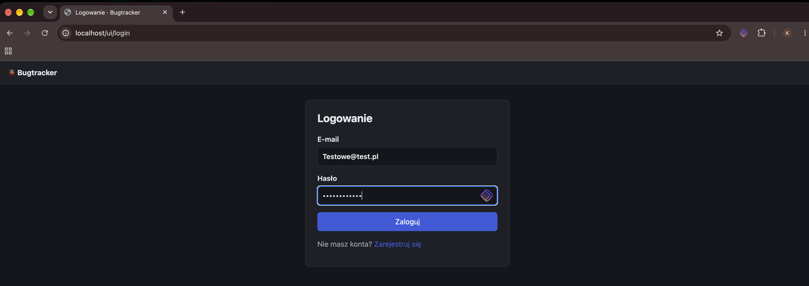
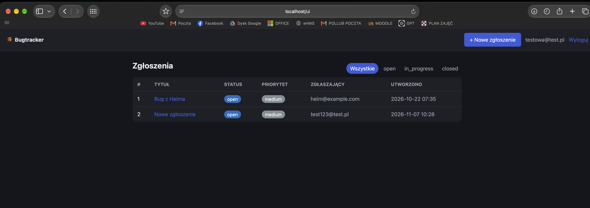
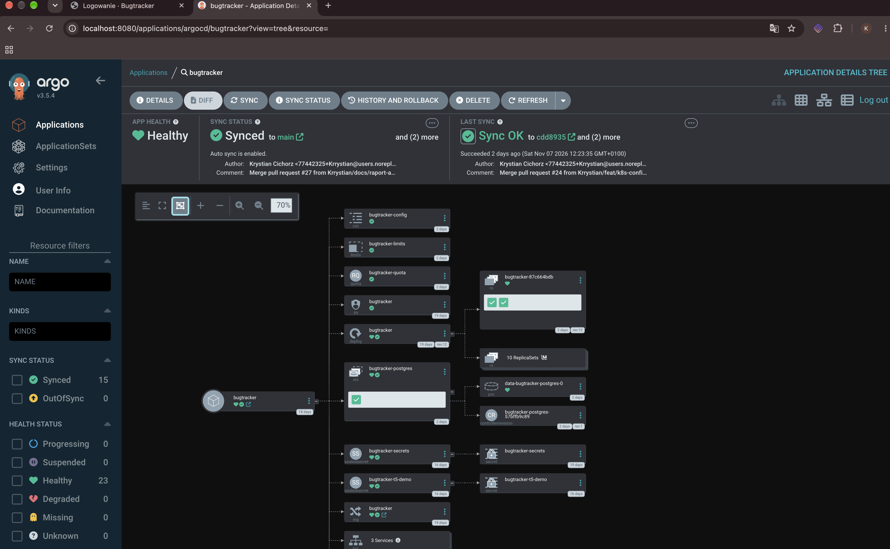
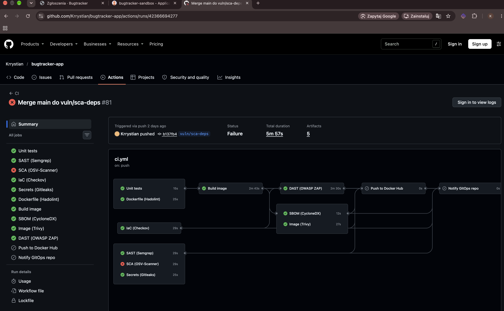
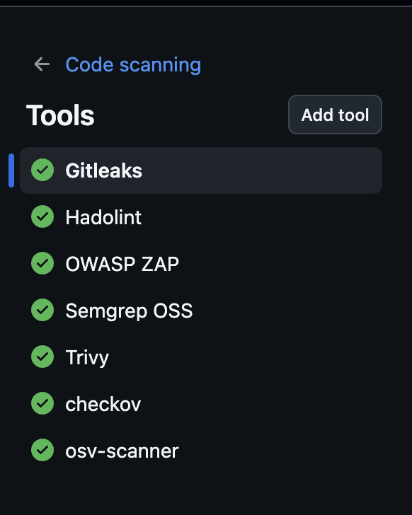
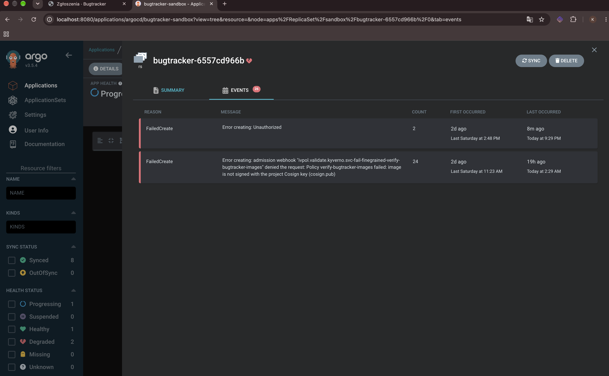
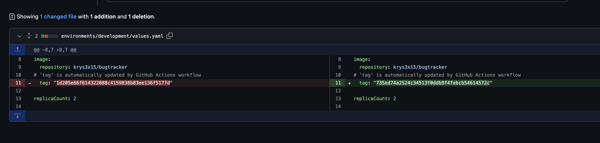
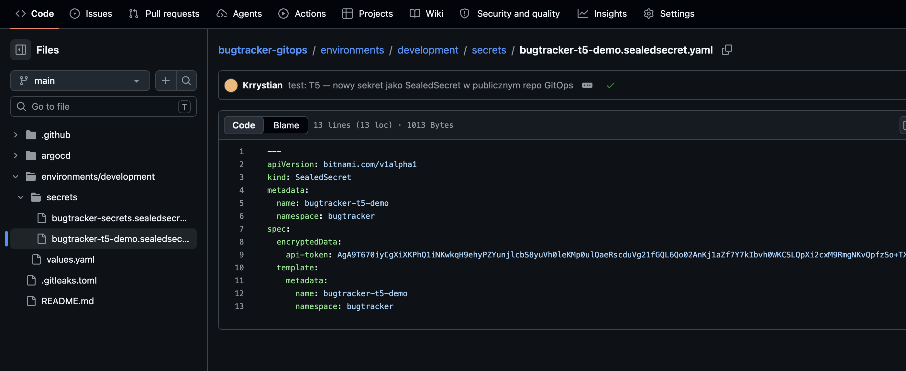
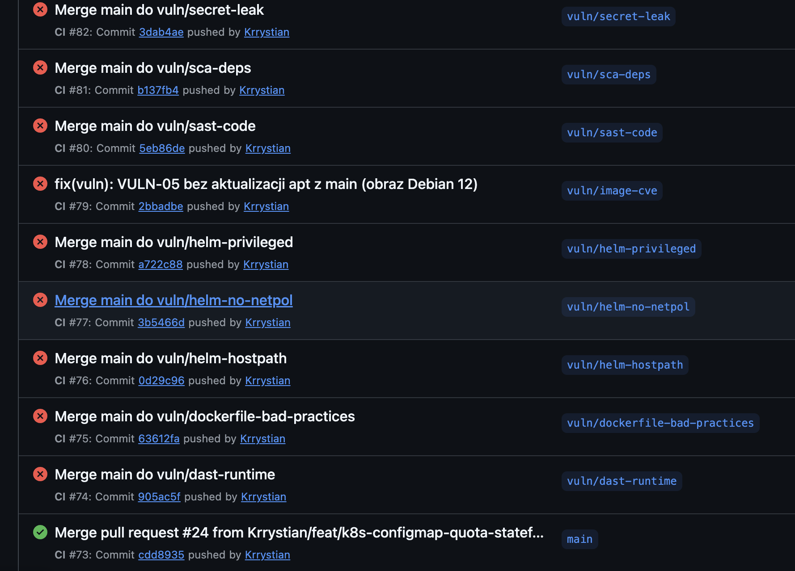

# Raport wdrożenia: Bugtracker w klastrze Kubernetes

Projekt „Bezpieczny potok GitOps (DevSecOps)”. Raport potwierdza wdrożenie systemu w klastrze Kubernetes (k3d) i przedstawia wyniki testów zaplanowanych w zadaniu cząstkowym nr 2 (testy akceptacyjne T1–T5) oraz testów obiektów Kubernetes.

- Repozytorium aplikacji (kod, Dockerfile, wykres Helm `charts/bugtracker`, manifesty, CI): https://github.com/Krrystian/bugtracker-app
- Repozytorium GitOps (wartości środowiska, `Application` Argo CD, `SealedSecret`): https://github.com/Krrystian/bugtracker-gitops

Wyniki poleceń w tym raporcie to prawdziwe wyniki z klastra `k3d-bugtracker`, zebrane 2026-11-07 po wdrożeniu wykresu w wersji 0.2.0 (commit `cdd8935` w `main`).

## Spis treści

1. [System i architektura](#1-system-i-architektura)
2. [Wymagane obiekty Kubernetes: gdzie są w repozytorium](#2-wymagane-obiekty-kubernetes-gdzie-są-w-repozytorium)
3. [Potwierdzenie wdrożenia](#3-potwierdzenie-wdrożenia)
4. [Testy obiektów Kubernetes](#4-testy-obiektów-kubernetes)
5. [Testy akceptacyjne T1–T5](#5-testy-akceptacyjne-t1t5)
6. [Gałęzie z podatnościami `vuln/*`](#6-gałęzie-z-podatnościami-vuln)
7. [Komentarz o funkcjonalności](#7-komentarz-o-funkcjonalności)

## 1. System i architektura

**Aplikacja:** bugtracker w Pythonie (FastAPI) z bazą PostgreSQL 16. Udostępnia interfejs webowy, API CRUD zgłoszeń, logowanie (hasła Argon2id) i endpoint `/health`, który sprawdza także połączenie z bazą.

**Klaster:** k3d (k3s v1.36.4) na Docker Desktop, jeden węzeł. W klastrze działają:

| Komponent | Rola |
|---|---|
| Traefik (wbudowany w k3s) | kontroler Ingress, `http://localhost` |
| Argo CD v3.5.4 | GitOps: wdraża aplikację z repozytoriów Git (Multiple Sources) |
| Sealed Secrets v0.40.0 | odszyfrowuje zaszyfrowane `SealedSecret` z repo GitOps do zwykłych `Secret` |
| Kyverno v1.19.1 | admission control: wpuszcza tylko obrazy podpisane kluczem Cosign projektu |
| cloudflared (Quick Tunnel) | tunel **wyłącznie** dla webhooka GitHub → Argo CD (`/api/webhook`) |

**Przepływ wdrożenia:**

```
push/PR ─► GitHub Actions (repo aplikacji)
           Semgrep, OSV-Scanner, Checkov, Gitleaks, Hadolint ─► build ─► Trivy, SBOM ─► DAST (ZAP w tymczasowym k3d)
           └─ tylko main, wszystkie bramki zielone: push do Docker Hub (tag = SHA commitu), podpis Cosign,
              repository_dispatch ─► repo GitOps: commit z nowym tagiem na gałęzi development
                                     └─ ręczny PR development ─► main (brama decyzyjna)
                                        └─ webhook ─► Cloudflare Tunnel ─► Argo CD ─► klaster k3d
                                           (wykres Helm z repo aplikacji + values i SealedSecret z repo GitOps)
                                           └─ Kyverno weryfikuje podpis obrazu przy tworzeniu poda
```

Aplikacja jest wdrażana jako wykres Helm `charts/bugtracker`. Argo CD `Application` `bugtracker` łączy trzy źródła: wykres z `bugtracker-app@main`, plik `environments/development/values.yaml` z `bugtracker-gitops@main` (referencja `$values`) i katalog `environments/development/secrets/` z zaszyfrowanymi sekretami.

## 2. Wymagane obiekty Kubernetes: gdzie są w repozytorium

Ścieżki względem repozytorium `bugtracker-app`, chyba że zaznaczono inaczej. Wszystkie obiekty działają w namespace `bugtracker`.

| Obiekt | Nazwa w klastrze | Plik | Polecenie weryfikujące |
|---|---|---|---|
| **Deployment** | `bugtracker` (aplikacja, 2 repliki) | `charts/bugtracker/templates/deployment.yaml` | `kubectl -n bugtracker get deploy -o wide` |
| **StatefulSet** | `bugtracker-postgres` (baza, 1 replika) | `charts/bugtracker/templates/postgres-statefulset.yaml` | `kubectl -n bugtracker get sts -o wide` |
| **Service** | `bugtracker`, `bugtracker-postgres` (ClusterIP), `bugtracker-postgres-headless` (headless dla StatefulSet) | `charts/bugtracker/templates/service.yaml`, `postgres-service.yaml` | `kubectl -n bugtracker get svc -o wide` |
| **NetworkPolicy** | `bugtracker-default-deny`, `bugtracker-app`, `bugtracker-postgres` | `charts/bugtracker/templates/networkpolicy.yaml` | `kubectl -n bugtracker describe networkpolicy` |
| **Ingress** | `bugtracker` (Traefik, host `localhost`) | `charts/bugtracker/templates/ingress.yaml` | `kubectl -n bugtracker get ingress`, `curl http://localhost/health` |
| **PVC** | `data-bugtracker-postgres-0` (z `volumeClaimTemplates`) | `charts/bugtracker/templates/postgres-statefulset.yaml` | `kubectl -n bugtracker get pvc` |
| **ConfigMap** | `bugtracker-config` (jawna konfiguracja) | `charts/bugtracker/templates/configmap.yaml` | `kubectl -n bugtracker describe cm bugtracker-config` |
| **Secret** | `bugtracker-secrets` (hasło bazy, klucz sesji), tworzony z `SealedSecret` | `bugtracker-gitops`: `environments/development/secrets/bugtracker-secrets.sealedsecret.yaml` | `kubectl -n bugtracker get sealedsecret,secret` |
| **Requests i Limits** | każdy kontener | `charts/bugtracker/values.yaml` (`app.resources`, `database.resources`) | `kubectl -n bugtracker get pods -o custom-columns=...` |
| **ResourceQuota** | `bugtracker-quota` | `charts/bugtracker/templates/resourcequota.yaml` (wartości: `values.yaml` → `resourceQuota`) | `kubectl -n bugtracker describe quota` |
| **LimitRange** | `bugtracker-limits` | `charts/bugtracker/templates/limitrange.yaml` (wartości: `values.yaml` → `limitRange`) | `kubectl -n bugtracker describe limitrange` |

Statyczne manifesty z wcześniejszego etapu (Docker Desktop, bez Helma) leżą w katalogu `k8s/`: `namespace.yaml`, `deployment.yaml`, `service.yaml`, `ingress.yaml`, `pvc.yaml`, `networkpolicy.yaml`.

### Obiekty i mechanizmy dodatkowe

| Obiekt / mechanizm | Plik | Uzasadnienie |
|---|---|---|
| **ServiceAccount** `bugtracker` z `automountServiceAccountToken: false` | `charts/bugtracker/templates/serviceaccount.yaml`, `deployment.yaml` | Pody nie dostają tokenu API Kubernetesa. Przejęta aplikacja nie może odpytywać API klastra. |
| **Namespace** z Pod Security Admission `restricted` | `bugtracker-gitops`: `argocd/application.yaml` (`managedNamespaceMetadata`), `k8s/namespace.yaml` | API serwera odrzuca pody z rootem, `privileged`, eskalacją uprawnień lub bez `seccompProfile`. |
| **SealedSecret** (CRD Bitnami) | `bugtracker-gitops`: `environments/development/secrets/*.sealedsecret.yaml` | Sekrety mogą leżeć w publicznym repozytorium, bo są zaszyfrowane kluczem publicznym kontrolera. Odszyfrować je może tylko klaster. |
| **Argo CD `Application`** (Multiple Sources) | `bugtracker-gitops`: `argocd/application.yaml`, `argocd/application-sandbox.yaml` | Stan klastra wynika z Gita (GitOps). `prune` i `selfHeal` cofają ręczne zmiany. Osobna piaskownica (`sandbox`) służy do testów podatnych wariantów. |
| **Kyverno `ImageValidatingPolicy`** `verify-bugtracker-images` | `infra/kyverno/verify-images.yaml` | Pod uruchomi tylko obraz z podpisem Cosign i podpisanym SBOM. Tag jest zamieniany na digest. To odpowiednik `ClusterPolicy`/`verifyImages`, ale `ClusterPolicy` nie odczytuje podpisów w formacie cosign v3. |
| **securityContext** (non-root, `readOnlyRootFilesystem`, `capabilities.drop: [ALL]`, `seccompProfile: RuntimeDefault`) | `values.yaml`, szablony | Ogranicza skutki przejęcia kontenera. Wymagane przez PSA `restricted`. |
| **Sondy** `startupProbe`, `readinessProbe`, `livenessProbe` | `deployment.yaml`, `postgres-statefulset.yaml` | Ruch trafia tylko do gotowych podów (readiness, `/health` sprawdza też bazę). Zawieszony kontener jest restartowany. |
| **Sekrety montowane jako pliki** (`/run/secrets/bugtracker`, tryb 0440) | `deployment.yaml` | Sekrety nie trafiają do zmiennych środowiskowych, które łatwo wyciekają (logi, `/proc`, zrzuty). |
| **`persistentVolumeClaimRetentionPolicy: Retain`** | `postgres-statefulset.yaml` | Usunięcie lub przeskalowanie StatefulSet nie kasuje danych bazy. |
| **Headless Service** | `postgres-service.yaml` | Stała nazwa DNS poda bazy (`bugtracker-postgres-0.bugtracker-postgres-headless`), wymagana przez StatefulSet. |
| **`checksum/config`** (adnotacja podu) | `deployment.yaml`, `postgres-statefulset.yaml` | Zmiana ConfigMap automatycznie restartuje pody, bo zmienne środowiskowe są czytane tylko przy starcie. |

## 3. Potwierdzenie wdrożenia

### 3.1. Klaster i namespace

```console
$ kubectl config current-context; k3d cluster list; kubectl get nodes -o wide
k3d-bugtracker
NAME         SERVERS   AGENTS   LOADBALANCER
bugtracker   1/1       0/0      true
NAME                      STATUS   ROLES           AGE   VERSION        INTERNAL-IP   EXTERNAL-IP   OS-IMAGE           KERNEL-VERSION            CONTAINER-RUNTIME
k3d-bugtracker-server-0   Ready    control-plane   16d   v1.36.4+k3s1   172.18.0.2    <none>        K3s v1.36.4+k3s1   7.0.14-linuxkit (arm64)   containerd://2.3.4-k3s1.36
```


> Zrzut do wykonania: terminal z wynikiem `kubectl config current-context`, `k3d cluster list` i `kubectl get nodes -o wide`.

```console
$ kubectl get ns bugtracker --show-labels
NAME         STATUS   AGE   LABELS
bugtracker   Active   16d   kubernetes.io/metadata.name=bugtracker,pod-security.kubernetes.io/enforce=restricted
```


> Zrzut do wykonania: terminal z wynikiem `kubectl get ns bugtracker --show-labels`, z widoczną etykietą `pod-security.kubernetes.io/enforce=restricted`.

### 3.2. Wszystkie obiekty w namespace `bugtracker`

```console
$ kubectl -n bugtracker get all,pvc,cm,secret,quota,limitrange,networkpolicy,ingress
NAME                             READY   STATUS    RESTARTS   AGE
pod/bugtracker-87c664bdb-dz4x6   1/1     Running   0          3m
pod/bugtracker-87c664bdb-r49sd   1/1     Running   0          2m44s
pod/bugtracker-postgres-0        1/1     Running   0          3m2s

NAME                                   TYPE        CLUSTER-IP      EXTERNAL-IP   PORT(S)    AGE
service/bugtracker                     ClusterIP   10.43.195.4     <none>        80/TCP     16d
service/bugtracker-postgres            ClusterIP   10.43.103.141   <none>        5432/TCP   16d
service/bugtracker-postgres-headless   ClusterIP   None            <none>        5432/TCP   3m2s

NAME                         READY   UP-TO-DATE   AVAILABLE   AGE
deployment.apps/bugtracker   2/2     2            2           16d

NAME                                    DESIRED   CURRENT   READY   AGE
replicaset.apps/bugtracker-6746bf47bf   0         0         0       14d
replicaset.apps/bugtracker-689d4788     0         0         0       15d
replicaset.apps/bugtracker-69f99989ff   0         0         0       13d
replicaset.apps/bugtracker-6bdfb689d9   0         0         0       13d
replicaset.apps/bugtracker-7748c65c89   0         0         0       13d
replicaset.apps/bugtracker-77b46f86bb   0         0         0       16d
replicaset.apps/bugtracker-77f554f595   0         0         0       14d
replicaset.apps/bugtracker-78c8c6b6fb   0         0         0       15d
replicaset.apps/bugtracker-87c664bdb    2         2         2       3m3s
replicaset.apps/bugtracker-b64b7d6b9    0         0         0       13d
replicaset.apps/bugtracker-f8c74bc66    0         0         0       14d

NAME                                   READY   AGE
statefulset.apps/bugtracker-postgres   1/1     3m3s

NAME                                               STATUS   VOLUME                                     CAPACITY   ACCESS MODES   STORAGECLASS   VOLUMEATTRIBUTESCLASS   AGE
persistentvolumeclaim/bugtracker-postgres-data     Bound    pvc-1f4ba622-130e-4863-b202-2ee495eb1843   1Gi        RWO            local-path     <unset>                 16d
persistentvolumeclaim/data-bugtracker-postgres-0   Bound    pvc-a9664699-f49c-49bf-af6d-374023f214d6   1Gi        RWO            local-path     <unset>                 3m3s

NAME                          DATA   AGE
configmap/bugtracker-config   7      3m3s
configmap/kube-root-ca.crt    1      16d

NAME                                      TYPE                 DATA   AGE
secret/bugtracker-secrets                 Opaque               2      16d
secret/bugtracker-t5-demo                 Opaque               1      13d
secret/sh.helm.release.v1.bugtracker.v1   helm.sh/release.v1   1      16d

NAME                             REQUEST                                                                                                                                                                                     LIMIT                                         AGE
resourcequota/bugtracker-quota   persistentvolumeclaims: 2/3, pods: 3/10, requests.cpu: 200m/1, requests.memory: 320Mi/1Gi, requests.storage: 2Gi/5Gi, services: 3/5, services.loadbalancers: 0/0, services.nodeports: 0/0   limits.cpu: 1500m/3, limits.memory: 1Gi/2Gi   3m3s

NAME                           CREATED AT
limitrange/bugtracker-limits   2026-11-07T10:58:48Z

NAME                                                      POD-SELECTOR                                                                                                   AGE
networkpolicy.networking.k8s.io/bugtracker-app            app.kubernetes.io/component=app,app.kubernetes.io/instance=bugtracker,app.kubernetes.io/name=bugtracker        16d
networkpolicy.networking.k8s.io/bugtracker-default-deny   app.kubernetes.io/instance=bugtracker                                                                          16d
networkpolicy.networking.k8s.io/bugtracker-postgres       app.kubernetes.io/component=database,app.kubernetes.io/instance=bugtracker,app.kubernetes.io/name=bugtracker   16d

NAME                                   CLASS     HOSTS       ADDRESS      PORTS   AGE
ingress.networking.k8s.io/bugtracker   traefik   localhost   172.18.0.2   80      16d
```


> Zrzut do wykonania: terminal z wynikiem `kubectl -n bugtracker get all,pvc,cm,secret,quota,limitrange,networkpolicy,ingress`. Wynik jest długi, więc można zrobić dwa zrzuty.

Uwagi do wyniku:
- ReplicaSety z `DESIRED 0` to historia Deploymentu (rollback). Kubernetes przechowuje je domyślnie (`revisionHistoryLimit: 10`).
- `secret/sh.helm.release.v1.bugtracker.v1` został po próbnej instalacji `helm install` z etapu 6. Argo CD nie używa Helma do instalacji (renderuje szablony), więc ten obiekt nie jest już używany.
- `persistentvolumeclaim/bugtracker-postgres-data` to PVC poprzedniej wersji bazy (Deployment). Został celowo zachowany jako kopia przy przejściu na StatefulSet (sekcja 3.5).

### 3.3. Deployment (aplikacja) i StatefulSet (baza)

```console
$ kubectl -n bugtracker get deploy bugtracker -o wide
NAME         READY   UP-TO-DATE   AVAILABLE   AGE   CONTAINERS   IMAGES                                                         SELECTOR
bugtracker   2/2     2            2           16d   bugtracker   krys3x15/bugtracker:1d205e66f614322088c4159838b83ee136f5177d   app.kubernetes.io/component=app,app.kubernetes.io/instance=bugtracker,app.kubernetes.io/name=bugtracker
```

```console
$ kubectl -n bugtracker get sts bugtracker-postgres -o wide
NAME                  READY   AGE    CONTAINERS   IMAGES
bugtracker-postgres   1/1     3m4s   postgres     postgres:16.15-alpine@sha256:721873c34ceb9f8d8fc265984940dc982404c105f19ad51be9fdc5970a6080ea
```

```console
$ kubectl -n bugtracker get sts bugtracker-postgres -o jsonpath='serviceName={.spec.serviceName} retention={.spec.persistentVolumeClaimRetentionPolicy}{"\n"}'; kubectl -n bugtracker get pod bugtracker-postgres-0 -o jsonpath='{.spec.volumes[?(@.name=="data")].persistentVolumeClaim.claimName}{"\n"}'
serviceName=bugtracker-postgres-headless retention={"whenDeleted":"Retain","whenScaled":"Retain"}
data-bugtracker-postgres-0
```


> Zrzut do wykonania: terminal z wynikiem `kubectl -n bugtracker get deploy bugtracker -o wide` i `kubectl -n bugtracker get sts bugtracker-postgres -o wide`, z widocznym tagiem obrazu (SHA commitu) i digestem postgresa.

Obraz aplikacji ma tag równy pełnemu SHA commitu, nie `latest`. Kyverno przy tworzeniu poda dopisał zweryfikowany digest:

```console
$ kubectl get imagevalidatingpolicy 2>/dev/null || kubectl get clusterpolicy; kubectl -n bugtracker get sa; kubectl -n bugtracker get pod -l app.kubernetes.io/component=app -o jsonpath='{.items[0].spec.containers[0].image}{"\n"}'
NAME                       AGE   READY
verify-bugtracker-images   13d   true
NAME         AGE
bugtracker   16d
default      16d
docker.io/krys3x15/bugtracker:1d205e66f614322088c4159838b83ee136f5177d@sha256:fb2464faac3be55123ba200bda75013038f915ef15564ee9d2dabb9905cf3fa3
```

### 3.4. Service i Ingress

```console
$ kubectl -n bugtracker get svc -o wide
NAME                           TYPE        CLUSTER-IP      EXTERNAL-IP   PORT(S)    AGE    SELECTOR
bugtracker                     ClusterIP   10.43.195.4     <none>        80/TCP     16d    app.kubernetes.io/component=app,app.kubernetes.io/instance=bugtracker,app.kubernetes.io/name=bugtracker
bugtracker-postgres            ClusterIP   10.43.103.141   <none>        5432/TCP   16d    app.kubernetes.io/component=database,app.kubernetes.io/instance=bugtracker,app.kubernetes.io/name=bugtracker
bugtracker-postgres-headless   ClusterIP   None            <none>        5432/TCP   3m4s   app.kubernetes.io/component=database,app.kubernetes.io/instance=bugtracker,app.kubernetes.io/name=bugtracker
```

```console
$ kubectl -n bugtracker get ingress -o wide; curl -s -i http://localhost/health | head -12
NAME         CLASS     HOSTS       ADDRESS      PORTS   AGE
bugtracker   traefik   localhost   172.18.0.2   80      16d
HTTP/1.1 200 OK
Cache-Control: no-store
Content-Length: 31
Content-Security-Policy: default-src 'none'; style-src 'self'; form-action 'self'; frame-ancestors 'none'; base-uri 'none'
Content-Type: application/json
Date: Sat, 07 Nov 2026 11:01:52 GMT
Referrer-Policy: no-referrer
Server: uvicorn
X-Content-Type-Options: nosniff
X-Frame-Options: DENY

{"status":"ok","database":"ok"}
```



> Zrzut do wykonania: terminal z wynikiem `kubectl -n bugtracker get svc -o wide` i `curl -i http://localhost/health`. Dodatkowo przeglądarka z otwartym `http://localhost` (strona logowania bugtrackera).



> Zrzut do wykonania: przeglądarka, `http://localhost`, lista zgłoszeń po zalogowaniu.

### 3.5. PVC i trwałość danych

```console
$ kubectl -n bugtracker get pvc -o wide; kubectl get pv
NAME                         STATUS   VOLUME                                     CAPACITY   ACCESS MODES   STORAGECLASS   VOLUMEATTRIBUTESCLASS   AGE    VOLUMEMODE
bugtracker-postgres-data     Bound    pvc-1f4ba622-130e-4863-b202-2ee495eb1843   1Gi        RWO            local-path     <unset>                 16d    Filesystem
data-bugtracker-postgres-0   Bound    pvc-a9664699-f49c-49bf-af6d-374023f214d6   1Gi        RWO            local-path     <unset>                 3m4s   Filesystem
NAME                                       CAPACITY   ACCESS MODES   RECLAIM POLICY   STATUS   CLAIM                                   STORAGECLASS   VOLUMEATTRIBUTESCLASS   REASON   AGE
pvc-1f4ba622-130e-4863-b202-2ee495eb1843   1Gi        RWO            Delete           Bound    bugtracker/bugtracker-postgres-data     local-path     <unset>                          16d
pvc-a9664699-f49c-49bf-af6d-374023f214d6   1Gi        RWO            Delete           Bound    bugtracker/data-bugtracker-postgres-0   local-path     <unset>                          3m2s
```


> Zrzut do wykonania: terminal z wynikiem `kubectl -n bugtracker get pvc -o wide` i `kubectl get pv`.

Przejście bazy z Deploymentu na StatefulSet (2026-11-07) zrobiłem tak:
1. kopia bazy (`pg_dump -Fc`, poza repozytorium),
2. adnotacja `argocd.argoproj.io/sync-options=Prune=false` na starym PVC, żeby Argo CD go nie usunął,
3. scalenie zmiany wykresu, po którym Argo CD utworzył StatefulSet z nowym PVC `data-bugtracker-postgres-0`,
4. odtworzenie danych (`pg_restore`): 2 zgłoszenia i 3 użytkowników, zgodnie z kopią.

Dane w nowej bazie:

```console
$ kubectl -n bugtracker exec bugtracker-postgres-0 -- psql -U bugtracker -d bugtracker -Atc 'select count(*) from bugs'; kubectl -n bugtracker exec deploy/bugtracker -- sh -c 'env | grep -E "^(DB_|SECRETS_DIR|ENABLE_DOCS|COOKIE_SECURE)" | sort; ls -l /run/secrets/bugtracker/'
2
COOKIE_SECURE=false
DB_HOST=bugtracker-postgres
DB_NAME=bugtracker
DB_PORT=5432
DB_USER=bugtracker
ENABLE_DOCS=false
SECRETS_DIR=/run/secrets/bugtracker
total 0
lrwxrwxrwx 1 root app 18 Nov  7 10:59 db_password -> ..data/db_password
lrwxrwxrwx 1 root app 17 Nov  7 10:59 secret_key -> ..data/secret_key
```

Ostatnie polecenie pokazuje też, że aplikacja dostała konfigurację z ConfigMap jako zmienne środowiskowe, a sekrety jako pliki w `/run/secrets/bugtracker`.

### 3.6. ConfigMap

```console
$ kubectl -n bugtracker describe configmap bugtracker-config
Name:         bugtracker-config
Namespace:    bugtracker
Labels:       app.kubernetes.io/instance=bugtracker
              app.kubernetes.io/managed-by=Helm
              app.kubernetes.io/name=bugtracker
              helm.sh/chart=bugtracker-0.2.0
Annotations:  argocd.argoproj.io/tracking-id: bugtracker:/ConfigMap:bugtracker/bugtracker-config

Data
====
COOKIE_SECURE:
----
false

DB_HOST:
----
bugtracker-postgres

DB_NAME:
----
bugtracker

DB_PORT:
----
5432

DB_USER:
----
bugtracker

ENABLE_DOCS:
----
false

SECRETS_DIR:
----
/run/secrets/bugtracker


BinaryData
====

Events:  <none>
```


> Zrzut do wykonania: terminal z wynikiem `kubectl -n bugtracker describe configmap bugtracker-config`.

### 3.7. Secret (z SealedSecret)

Wartości sekretów nie są wypisywane. `describe` pokazuje tylko nazwy kluczy i rozmiary.

```console
$ kubectl -n bugtracker get sealedsecret; kubectl -n bugtracker describe secret bugtracker-secrets
NAME                 AGE
bugtracker-secrets   13d
bugtracker-t5-demo   13d
Name:         bugtracker-secrets
Namespace:    bugtracker
Labels:       <none>
Annotations:  <none>

Type:  Opaque

Data
====
db-password:  32 bytes
secret-key:   64 bytes
```


> Zrzut do wykonania: terminal z wynikiem `kubectl -n bugtracker get sealedsecret` i `kubectl -n bugtracker describe secret bugtracker-secrets`. **Nie** rób zrzutu `kubectl get secret -o yaml`, bo pokazuje wartości zakodowane base64.

### 3.8. NetworkPolicy

```console
$ kubectl -n bugtracker get networkpolicy; kubectl -n bugtracker describe networkpolicy bugtracker-postgres
NAME                      POD-SELECTOR                                                                                                   AGE
bugtracker-app            app.kubernetes.io/component=app,app.kubernetes.io/instance=bugtracker,app.kubernetes.io/name=bugtracker        16d
bugtracker-default-deny   app.kubernetes.io/instance=bugtracker                                                                          16d
bugtracker-postgres       app.kubernetes.io/component=database,app.kubernetes.io/instance=bugtracker,app.kubernetes.io/name=bugtracker   16d
Name:         bugtracker-postgres
Namespace:    bugtracker
Created on:   2026-10-22 09:35:28 +0200 CEST
Labels:       app.kubernetes.io/instance=bugtracker
              app.kubernetes.io/managed-by=Helm
              app.kubernetes.io/name=bugtracker
              helm.sh/chart=bugtracker-0.2.0
Annotations:  argocd.argoproj.io/tracking-id: bugtracker:networking.k8s.io/NetworkPolicy:bugtracker/bugtracker-postgres
              meta.helm.sh/release-name: bugtracker
              meta.helm.sh/release-namespace: bugtracker
Spec:
  PodSelector:     app.kubernetes.io/component=database,app.kubernetes.io/instance=bugtracker,app.kubernetes.io/name=bugtracker
  Allowing ingress traffic:
    To Port: 5432/TCP
    From:
      PodSelector: app.kubernetes.io/component=app,app.kubernetes.io/instance=bugtracker,app.kubernetes.io/name=bugtracker
  Allowing egress traffic:
    <none> (Selected pods are isolated for egress connectivity)
  Policy Types: Ingress, Egress
```


> Zrzut do wykonania: terminal z wynikiem `kubectl -n bugtracker get networkpolicy` i `kubectl -n bugtracker describe networkpolicy bugtracker-postgres`.

### 3.9. Requests i Limits, ResourceQuota, LimitRange

```console
$ kubectl -n bugtracker get pods -o custom-columns='POD:.metadata.name,CPU_REQ:.spec.containers[*].resources.requests.cpu,MEM_REQ:.spec.containers[*].resources.requests.memory,CPU_LIM:.spec.containers[*].resources.limits.cpu,MEM_LIM:.spec.containers[*].resources.limits.memory'
POD                          CPU_REQ   MEM_REQ   CPU_LIM   MEM_LIM
bugtracker-87c664bdb-dz4x6   50m       96Mi      500m      256Mi
bugtracker-87c664bdb-r49sd   50m       96Mi      500m      256Mi
bugtracker-postgres-0        100m      128Mi     500m      512Mi
```

```console
$ kubectl -n bugtracker describe resourcequota bugtracker-quota
Name:                   bugtracker-quota
Namespace:              bugtracker
Resource                Used   Hard
--------                ----   ----
limits.cpu              1500m  3
limits.memory           1Gi    2Gi
persistentvolumeclaims  2      3
pods                    3      10
requests.cpu            200m   1
requests.memory         320Mi  1Gi
requests.storage        2Gi    5Gi
services                3      5
services.loadbalancers  0      0
services.nodeports      0      0
```

```console
$ kubectl -n bugtracker describe limitrange bugtracker-limits
Name:                  bugtracker-limits
Namespace:             bugtracker
Type                   Resource  Min    Max  Default Request  Default Limit  Max Limit/Request Ratio
----                   --------  ---    ---  ---------------  -------------  -----------------------
Container              cpu       10m    1    50m              250m           -
Container              memory    32Mi   1Gi  64Mi             256Mi          -
PersistentVolumeClaim  storage   100Mi  2Gi  -                -              -
```


> Zrzut do wykonania: terminal z wynikami trzech poleceń z tej sekcji.

ResourceQuota jest dobrana do 2 podów aplikacji, 1 dodatkowego poda podczas rolling update i bazy, z zapasem. Zabrania usług `LoadBalancer` i `NodePort`, więc aplikacji nie da się wystawić z pominięciem Ingress.

### 3.10. Argo CD i Kyverno

```console
$ kubectl -n argocd get applications; kubectl -n argocd get application bugtracker -o jsonpath='{range .status.resources[?(@.status!="Synced")]}{.kind}/{.name}: {.status}{"\n"}{end}'
NAME                 SYNC STATUS   HEALTH STATUS
bugtracker           OutOfSync     Healthy
bugtracker-sandbox   OutOfSync     Degraded
PersistentVolumeClaim/bugtracker-postgres-data: OutOfSync
```



> Zrzut do wykonania: (1) terminal z wynikiem `kubectl -n argocd get applications`; (2) interfejs Argo CD (`kubectl -n argocd port-forward svc/argocd-server 8080:443`, potem `https://localhost:8080`) z drzewem zasobów aplikacji `bugtracker`.

Stan `OutOfSync` aplikacji `bugtracker` wynika **tylko** ze starego PVC `bugtracker-postgres-data`, który celowo chroni adnotacja `Prune=false` (sekcja 3.5). Wszystkie pozostałe zasoby są `Synced`, a aplikacja jest `Healthy`. Po usunięciu starego PVC stan zmieni się na `Synced`. Aplikacja `bugtracker-sandbox` (piaskownica, ręczna synchronizacja) jest `Degraded` celowo: Kyverno nie wpuszcza tam niepodpisanego obrazu (test T3).

## 4. Testy obiektów Kubernetes

Testy wykonano na działającym klastrze. Polecenia z `--dry-run=server` przechodzą przez pełną walidację i admission serwera API (LimitRange, ResourceQuota, Pod Security), ale niczego nie tworzą.

### 4.1. LimitRange: kontener chce więcej niż maksimum

Cel: kontener z limitem 2 CPU (maksimum LimitRange to 1 CPU) ma zostać odrzucony.

```console
$ kubectl -n bugtracker run test-limitrange --image=postgres:16.15-alpine@sha256:721873c34ceb9f8d8fc265984940dc982404c105f19ad51be9fdc5970a6080ea --restart=Never --dry-run=server --overrides="$(cat o1.json)"
Error from server (Forbidden): pods "test-limitrange" is forbidden: maximum cpu usage per Container is 1, but limit is 2
```

**Wynik:** ✅ odrzucony przez LimitRange.


> Zrzut do wykonania: terminal z poleceniem i komunikatem `maximum cpu usage per Container is 1, but limit is 2`. Pełna treść `--overrides` (pod zgodny z PSA `restricted`, `resources.limits.cpu: "2"`) jest opisana niżej.

### 4.2. LimitRange: wartości domyślne

Cel: kontener **bez** `resources` dostaje domyślne requests/limits z LimitRange.

```console
$ kubectl -n bugtracker run test-defaults --image=postgres:16.15-alpine@sha256:721873c34ceb9f8d8fc265984940dc982404c105f19ad51be9fdc5970a6080ea --restart=Never --dry-run=server --overrides="$(cat o3.json)" -o jsonpath='{.spec.containers[0].resources}{"\n"}'
{"limits":{"cpu":"250m","memory":"256Mi"},"requests":{"cpu":"50m","memory":"64Mi"}}
```

**Wynik:** ✅ serwer dopisał `requests 50m/64Mi` i `limits 250m/256Mi`.


> Zrzut do wykonania: terminal z poleceniem i wynikiem JSON z dopisanymi zasobami.

### 4.3. ResourceQuota: przekroczenie limitu namespace'u

Cel: pod z `requests.cpu: 900m` (pojedynczo w granicach LimitRange) przekroczyłby łączny limit `requests.cpu: 1` namespace'u (200m jest już zajęte).

```console
$ kubectl -n bugtracker run test-quota --image=postgres:16.15-alpine@sha256:721873c34ceb9f8d8fc265984940dc982404c105f19ad51be9fdc5970a6080ea --restart=Never --dry-run=server --overrides="$(cat o2.json)"
Error from server (Forbidden): pods "test-quota" is forbidden: exceeded quota: bugtracker-quota, requested: requests.cpu=900m, used: requests.cpu=200m, limited: requests.cpu=1
```

**Wynik:** ✅ odrzucony przez ResourceQuota.

```console
$ kubectl -n bugtracker create service loadbalancer test-lb --tcp=80:8000 --dry-run=server
error: failed to create LoadBalancer service: services "test-lb" is forbidden: exceeded quota: bugtracker-quota, requested: services.loadbalancers=1,services.nodeports=1, used: services.loadbalancers=0,services.nodeports=0, limited: services.loadbalancers=0,services.nodeports=0
```

**Wynik:** ✅ usługa `LoadBalancer` odrzucona (`services.loadbalancers: 0`).


> Zrzut do wykonania: terminal z oboma komunikatami `exceeded quota: bugtracker-quota`.

### 4.4. Pod Security Admission `restricted`

Cel: zwykły pod (root, bez `securityContext`) ma zostać odrzucony w namespace `bugtracker`.

```console
$ kubectl -n bugtracker run test-root --image=postgres:16.15-alpine@sha256:721873c34ceb9f8d8fc265984940dc982404c105f19ad51be9fdc5970a6080ea --restart=Never --dry-run=server
Error from server (Forbidden): pods "test-root" is forbidden: violates PodSecurity "restricted:latest": allowPrivilegeEscalation != false (container "test-root" must set securityContext.allowPrivilegeEscalation=false), unrestricted capabilities (container "test-root" must set securityContext.capabilities.drop=["ALL"]), runAsNonRoot != true (pod or container "test-root" must set securityContext.runAsNonRoot=true), seccompProfile (pod or container "test-root" must set securityContext.seccompProfile.type to "RuntimeDefault" or "Localhost")
```

**Wynik:** ✅ odrzucony przez PSA `restricted`.


> Zrzut do wykonania: terminal z komunikatem `violates PodSecurity "restricted:latest"`.

### 4.5. NetworkPolicy: dozwolony i zablokowany ruch

Cel: aplikacja łączy się z bazą (dozwolone), ale nie z internetem. Baza nie ma żadnego ruchu wychodzącego.

```console
$ kubectl -n bugtracker exec deploy/bugtracker -- python -c "import socket; s=socket.socket(); s.settimeout(3); s.connect(('bugtracker-postgres',5432)); print('app -> postgres:5432 OK')"; kubectl -n bugtracker exec deploy/bugtracker -- python -c "import socket; s=socket.socket(); s.settimeout(3); s.connect(('1.1.1.1',443)); print('app -> internet OK')"
app -> postgres:5432 OK
Traceback (most recent call last):
  File "<string>", line 1, in <module>
ConnectionRefusedError: [Errno 111] Connection refused
command terminated with exit code 1
```

```console
$ kubectl -n bugtracker exec bugtracker-postgres-0 -- sh -c 'timeout 3 nc -z -w 3 1.1.1.1 443 && echo "postgres -> internet OK" || echo "postgres -> internet ZABLOKOWANE (exit $?)"'
postgres -> internet ZABLOKOWANE (exit 1)
```

**Wynik:** ✅ aplikacja → baza działa, aplikacja → internet i baza → internet są zablokowane. W k3s polityki egzekwuje kube-router: odrzucone połączenie kończy się `Connection refused` zamiast czekania do timeoutu.


> Zrzut do wykonania: terminal z wynikami obu poleceń (`app -> postgres:5432 OK` oraz `ConnectionRefusedError` / `ZABLOKOWANE`).

### 4.6. StatefulSet: stabilna nazwa DNS przez headless Service

```console
$ kubectl -n bugtracker exec deploy/bugtracker -- python -c "import socket; print(socket.gethostbyname('bugtracker-postgres-0.bugtracker-postgres-headless'))"
10.42.0.78
$ kubectl -n bugtracker get pod bugtracker-postgres-0 -o jsonpath='{.status.podIP}'
10.42.0.78
```

**Wynik:** ✅ nazwa `bugtracker-postgres-0.bugtracker-postgres-headless` wskazuje IP poda bazy.


> Zrzut do wykonania: terminal z oboma poleceniami i tym samym adresem IP.

### 4.7. ServiceAccount bez uprawnień

Cel: konto usługi aplikacji nie ma dostępu do API Kubernetesa (ani do sekretów, ani do podów), a token nie jest montowany.

```console
$ kubectl auth can-i get secrets -n bugtracker --as=system:serviceaccount:bugtracker:bugtracker; kubectl auth can-i list pods -n bugtracker --as=system:serviceaccount:bugtracker:bugtracker; kubectl -n bugtracker get deploy bugtracker -o jsonpath='automountServiceAccountToken={.spec.template.spec.automountServiceAccountToken}{"\n"}'
no
no
automountServiceAccountToken=false
```

**Wynik:** ✅ brak uprawnień, token niemontowany.


> Zrzut do wykonania: terminal z wynikami `kubectl auth can-i` (`no`, `no`) i `automountServiceAccountToken=false`.

Pliki `--overrides` użyte w testach 4.1–4.3 (pod zgodny z PSA `restricted`, różniący się tylko polem `resources`):

```json
{"apiVersion":"v1","spec":{"securityContext":{"runAsNonRoot":true,"runAsUser":10001,"seccompProfile":{"type":"RuntimeDefault"}},
 "containers":[{"name":"t","image":"postgres:16.15-alpine@sha256:7218…","command":["sleep","60"],
  "securityContext":{"allowPrivilegeEscalation":false,"capabilities":{"drop":["ALL"]}},
  "resources": <4.1: {"requests":{"cpu":"2"},"limits":{"cpu":"2","memory":"128Mi"}}
               | 4.2: {}
               | 4.3: {"requests":{"cpu":"900m","memory":"64Mi"},"limits":{"cpu":"1","memory":"128Mi"}}> }]}}
```

## 5. Testy akceptacyjne T1–T5

Testy zaplanowane w zadaniu cząstkowym nr 2 (dokumentacja techniczna projektu). Szczegółowy przebieg i dowody: [`docs/test-results.md`](test-results.md), wyniki skanerów: [`docs/scan-results.md`](scan-results.md).

| Test | Cel | Wynik |
|---|---|---|
| T1 | Podatna biblioteka przerywa pipeline i jest raportowana | ✅ 2026-10-24 |
| T2 | Raporty wszystkich skanerów (SARIF) w jednym panelu GitHub Security | ✅ 2026-10-24 |
| T3 | Niepodpisany obraz odrzucony przez Kyverno | ✅ 2026-10-24, potwierdzony ponownie 2026-11-07 |
| T4 | Nowy obraz trafia tylko na `development`, wdrożenie wymaga ręcznego PR | ✅ 2026-10-24 |
| T5 | Sekret z `SealedSecret` odszyfrowany w klastrze, jawna wartość nigdzie nie wycieka | ✅ 2026-10-24 |

### T1: Blokada i raportowanie podatności kodu (SAST/SCA)

- **Cel:** przestarzała biblioteka z krytyczną CVE (baza OSV.dev) przerywa pipeline, a w Security → Code scanning pojawia się raport wskazujący bibliotekę.
- **Przebieg:** push gałęzi `vuln/sca-deps` (VULN-04: `urllib3==1.22` w `requirements.in` i lock files).
- **Polecenia:**
  ```bash
  gh run list --branch vuln/sca-deps --limit 1
  gh run view 40075903495
  gh api 'repos/Krrystian/bugtracker-app/code-scanning/alerts?ref=refs/heads/vuln/sca-deps&tool_name=osv-scanner' --jq '.[0].rule.description'
  ```
- **Oczekiwany wynik:** job `SCA (OSV-Scanner)` czerwony, obraz nieopublikowany.
- **Uzyskany wynik:** [przebieg 40075903495](https://github.com/Krrystian/bugtracker-app/actions/runs/40075903495): `SCA (OSV-Scanner)` ❌ (krok bramki), pozostałe joby ✅, `Push to Docker Hub` i `Notify GitOps repo` pominięte. W Code scanning 48 alertów osv-scanner, w tym **Critical CVE-2018-20060** („Package 'urllib3@1.22' is vulnerable…”). Na `main`: 0 alertów. ✅



> Zrzut do wykonania: GitHub → Actions → przebieg 40075903495 (graf jobów z czerwonym `SCA (OSV-Scanner)`) oraz Security → Code scanning, filtr `branch:vuln/sca-deps tool:osv-scanner`, alert CVE-2018-20060.

### T2: Centralizacja raportów (SARIF)

- **Cel:** push `vuln/helm-privileged` (kontener jako root): Checkov generuje SARIF, a wyniki skanerów statycznych i DAST są widoczne we wspólnym panelu GitHub Security.
- **Polecenia:**
  ```bash
  gh run view 40078615628
  gh api 'repos/Krrystian/bugtracker-app/code-scanning/analyses?ref=refs/heads/main' --jq '[.[].tool.name] | unique'
  ```
- **Uzyskany wynik:** [przebieg 40078615628](https://github.com/Krrystian/bugtracker-app/actions/runs/40078615628): `IaC (Checkov)` ❌, SARIF wysłany (`if: always()`), alerty CKV_K8S_23 („Minimize the admission of root containers”) i CKV_K8S_16 („Container should not be privileged”). Panel Security dla `main` zawiera analizy: Semgrep OSS (SAST), osv-scanner (SCA), checkov (IaC), OWASP ZAP (DAST), a także Trivy, Gitleaks i Hadolint (stan 2026-11-07: 7 narzędzi). ✅



> Zrzut do wykonania: GitHub → Security → Code scanning z listą narzędzi (filtr „Tool”) oraz alert Checkov CKV_K8S_23 na gałęzi `vuln/helm-privileged`.

### T3: Integralność i weryfikacja podpisów Cosign

- **Cel:** podmiana obrazu w `values.yaml` repo GitOps na losowy niepodpisany (`vuln/unsigned-image`, `nginx:1.27.3-alpine`), wdrożenie w piaskownicy: Kyverno blokuje pod z błędem braku podpisu.
- **Polecenia** (stan aktualny, 2026-11-07):
  ```bash
  kubectl -n argocd get application bugtracker-sandbox
  kubectl -n sandbox get events --field-selector reason=FailedCreate
  kubectl -n sandbox get pods
  ```
- **Uzyskany wynik:**

```console
$ kubectl -n sandbox get events --field-selector reason=FailedCreate --sort-by=.lastTimestamp | tail -3; kubectl -n sandbox get pods
12d         Warning   FailedCreate   replicaset/bugtracker-6557cd966b   Error creating: admission webhook "ivpol.validate.kyverno.svc-fail-finegrained-verify-bugtracker-images" denied the request: Policy verify-bugtracker-images failed: image is not signed with the project Cosign key (cosign.pub)
39m         Warning   FailedCreate   replicaset/bugtracker-6557cd966b   Error creating: Internal error occurred: failed calling webhook "ivpol.mutate.kyverno.svc-fail-finegrained-verify-bugtracker-images": failed to call webhook: Post "https://kyverno-svc.kyverno.svc:443/ivpol/mutate/verify-bugtracker-images?timeout=30s": no endpoints available for service "kyverno-svc"
14s         Warning   FailedCreate   replicaset/bugtracker-6557cd966b   Error creating: admission webhook "ivpol.validate.kyverno.svc-fail-finegrained-verify-bugtracker-images" denied the request: Policy verify-bugtracker-images failed: image is not signed with the project Cosign key (cosign.pub)
No resources found in sandbox namespace.
```

Kyverno odrzuca każdą próbę utworzenia poda (`image is not signed with the project Cosign key (cosign.pub)`), w `sandbox` jest 0 podów. Środkowe zdarzenie (`no endpoints available for service "kyverno-svc"`) pochodzi z chwili startu klastra, gdy Kyverno jeszcze nie działał. Polityka ma `failurePolicy: Fail`, więc i wtedy pod nie powstał. Kontrola pozytywna: pody produkcyjne z podpisanym obrazem są przyjmowane (sekcja 3.3, digest dopisany przez Kyverno). ✅



> Zrzut do wykonania: terminal z wynikiem `kubectl -n sandbox get events --field-selector reason=FailedCreate` oraz Argo CD UI z aplikacją `bugtracker-sandbox` (komunikat błędu przy ReplicaSet).

### T4: Brama wdrożeniowa

- **Cel:** po zielonym CI nowy tag obrazu trafia do repo GitOps tylko na gałąź `development`. Działająca aplikacja nie zmienia się do ręcznego scalenia `development` → `main`.
- **Polecenia:**
  ```bash
  git -C bugtracker-gitops show origin/development:environments/development/values.yaml | grep tag:
  git -C bugtracker-gitops show origin/main:environments/development/values.yaml | grep tag:
  kubectl -n bugtracker get deploy bugtracker -o jsonpath='{.spec.template.spec.containers[0].image}'
  ```
- **Uzyskany wynik:** CI aplikacji ([40072560307](https://github.com/Krrystian/bugtracker-app/actions/runs/40072560307)) opublikował obraz `50c4eb5…` i wysłał `repository_dispatch`. Workflow GitOps ([40072686137](https://github.com/Krrystian/bugtracker-gitops/actions/runs/40072686137)) zrobił commit `deploy: bugtracker 50c4eb5` **na `development`**. `main` GitOps i klaster pozostały przy poprzednim tagu `4945053…` do ręcznego PR. ✅



> Zrzut do wykonania: GitHub → bugtracker-gitops → porównanie `main...development` (różnica w `image.tag`) oraz lista commitów `development` z commitem `github-actions[bot]`.

### T5: Szczelność sekretów

- **Cel:** nowy sekret zaszyfrowany `kubeseal` jako `SealedSecret` w publicznym repo GitOps, wdrożenie: sekret odszyfrowany w klastrze, a jawne hasło nie pojawia się w logach ani w historii gita.
- **Polecenia:**
  ```bash
  kubectl -n bugtracker get sealedsecret bugtracker-t5-demo
  kubectl -n bugtracker get secret bugtracker-t5-demo -o jsonpath='{.metadata.ownerReferences[0].kind}'
  # porównanie skrótu SHA-256 wartości w klastrze z oryginałem (wartość nie jest wypisywana)
  ```
- **Uzyskany wynik:** [bugtracker-gitops#6](https://github.com/Krrystian/bugtracker-gitops/pull/6): Gitleaks przepuścił szyfrogram, Argo CD wdrożył `SealedSecret`, kontroler utworzył `Secret` (właściciel: `SealedSecret`). SHA-256 wartości w klastrze jest zgodny z oryginałem. 0 wystąpień wartości (jawnie i w base64) w historii obu repozytoriów (wszystkie gałęzie), w logach Argo CD, kontrolera Sealed Secrets i CI. Dodatkowo `vuln/plaintext-secret` (jawny `Secret`) zatrzymany przez Gitleaks ([40099839420](https://github.com/Krrystian/bugtracker-gitops/actions/runs/40099839420)). ✅



> Zrzut do wykonania: plik `bugtracker-t5-demo.sealedsecret.yaml` w GitHubie (widoczny tylko szyfrogram) oraz terminal z `kubectl -n bugtracker get sealedsecret,secret`.

## 6. Gałęzie z podatnościami `vuln/*`

`main` to wersja secure. Każda gałąź `vuln/*` psuje dokładnie jedną rzecz i ma zostać zatrzymana przez **jedną, zaplanowaną bramkę**. Te gałęzie nigdy nie są scalane do `main`. Opis każdej podatności: [`docs/vulnerabilities.md`](vulnerabilities.md).

| ID | Gałąź | Repo | Co psuje | Bramka | Ostatni przebieg |
|---|---|---|---|---|---|
| VULN-01 | `vuln/secret-leak` | app | sztuczny klucz API w kodzie | Secrets (Gitleaks) | <!-- TODO: run-id --> |
| VULN-02 | `vuln/dockerfile-bad-practices` | app | `latest`, root, brak przypięć | Dockerfile (Hadolint) | <!-- TODO: run-id --> |
| VULN-03 | `vuln/sast-code` | app | SQL injection, XSS, MD5 | SAST (Semgrep) | <!-- TODO: run-id --> |
| VULN-04 | `vuln/sca-deps` | app | `urllib3 1.22` (CVE-2018-20060) | SCA (OSV-Scanner), T1 | <!-- TODO: run-id --> |
| VULN-05 | `vuln/image-cve` | app | obraz bazowy z 2023 r. | Image (Trivy) | <!-- TODO: run-id --> |
| VULN-06 | `vuln/helm-privileged` | app | root, `privileged`, brak limitów | IaC (Checkov), T2 | <!-- TODO: run-id --> |
| VULN-07 | `vuln/helm-no-netpol` | app | brak NetworkPolicy | IaC (Checkov) | <!-- TODO: run-id --> |
| VULN-08 | `vuln/dast-runtime` | app | proxy usuwa nagłówki bezpieczeństwa | DAST (OWASP ZAP) | <!-- TODO: run-id --> |
| VULN-09 | `vuln/unsigned-image` | gitops | niepodpisany obraz w `values.yaml` | Kyverno (admission), T3 | piaskownica, sekcja T3 |
| VULN-10 | `vuln/plaintext-secret` | gitops | jawny `Secret` zamiast `SealedSecret` | Secrets (Gitleaks) repo GitOps | <!-- TODO: run-id --> |
| VULN-11 | `vuln/helm-hostpath` | app | `hostPath` `/var/run/docker.sock` w podzie aplikacji | IaC (Checkov) | <!-- TODO: run-id --> |

Linki do najnowszych przebiegów zostaną uzupełnione po aktualizacji gałęzi `vuln/*` do bieżącego `main` (wykres 0.2.0). Poprzednia, pełna macierz z 2026-10-24: [`docs/scan-results.md`](scan-results.md) i [`docs/test-results.md`](test-results.md) (etap 13).



> Zrzut do wykonania: GitHub → Actions, lista przebiegów z filtrem gałęzi `vuln/*` (każdy z jednym czerwonym jobem) oraz jeden przebieg zielony na `main`.

## 7. Komentarz o funkcjonalności

**Zakładane i osiągnięte:**

| Założenie | Stan |
|---|---|
| Aplikacja CRUD z bazą, uruchomiona w Kubernetesie | ✅ 2 repliki aplikacji, PostgreSQL jako StatefulSet z trwałym wolumenem |
| Wszystkie wymagane obiekty K8s skonfigurowane i działające | ✅ sekcje 2–4 |
| Konfiguracja jawna oddzielona od tajnej | ✅ ConfigMap (zmienne środowiskowe) i Secret z SealedSecret (pliki) |
| Izolacja sieciowa | ✅ default-deny i jawne wyjątki (Ingress → aplikacja → baza, DNS) |
| Kontrola zasobów | ✅ requests/limits w każdym kontenerze, LimitRange, ResourceQuota |
| Wdrażanie przez GitOps z ręczną bramą | ✅ Argo CD, PR `development` → `main` (T4) |
| Bezpieczeństwo łańcucha dostaw | ✅ 7 skanerów jako bramki (Semgrep, OSV-Scanner, Checkov, Gitleaks, Hadolint, Trivy, ZAP), SBOM, podpis Cosign, weryfikacja Kyverno (T1–T3) |
| Sekrety poza repozytorium w jawnej postaci | ✅ Sealed Secrets (T5) |

**Znane ograniczenia:**
- **Cloudflare Quick Tunnel** (bez konta i domeny) dostaje nowy adres po każdym restarcie poda `cloudflared`. Webhook GitHub trzeba wtedy przestawić skryptem `scripts/update-webhook-url.sh`. Do tego czasu Argo CD synchronizuje się co 3 minuty (odpytywanie). Trwałe rozwiązanie to nazwany tunel z własną domeną.
- **Tymczasowa aktualizacja `apt` w Dockerfile:** 2026-11-04 opublikowano CVE-2026-109518 (High) w `apt` 3.0.3. Najnowszy obraz bazowy `python:3.12.15-slim-trixie` nie ma jeszcze poprawki, więc Trivy zablokował build. Etap runtime instaluje `apt=3.0.4` (przypięta wersja). Do usunięcia, gdy obraz bazowy dostanie poprawkę.
- **Jedna replika PostgreSQL:** StatefulSet zapewnia stałą tożsamość i trwały wolumen, ale nie wysoką dostępność. Restart bazy oznacza krótką przerwę. Replikacja (np. operator CloudNativePG) wykracza poza zakres projektu.
- **Klaster jednowęzłowy (k3d) z `local-path`:** wolumen jest związany z węzłem. Na produkcji potrzebna byłaby sieciowa klasa pamięci i kopie zapasowe bazy.
- **Kopia klucza kontrolera Sealed Secrets** musi być przechowywana poza klastrem. Bez niej po odtworzeniu klastra istniejących `SealedSecret` nie da się odszyfrować.
